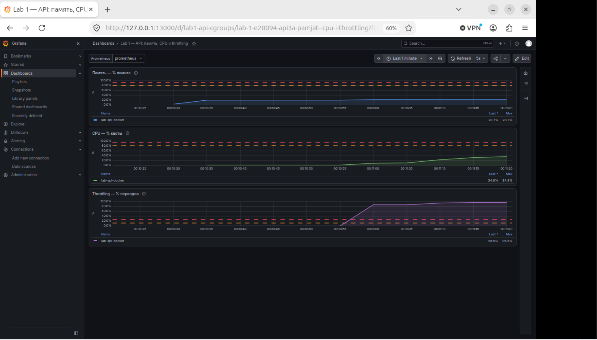

# Лабораторная работа № 1. Как устроен контейнер

Работа выполнялась в VM на Ubuntu 26.4.

Файлы работы: [код API](api/main.go), [mydocker.sh](mydocker.sh), [seccomp-фильтр](seccomp-no-mkdir.bpf), [профиль AppArmor](lab1-unshare.apparmor), [Dockerfile](Dockerfile), [Dockerfile.multistage](Dockerfile.multistage), [конфиг gVisor](gvisor-bundle/config.json), [Compose](monitoring/compose.yaml) и [Prometheus](monitoring/prometheus.yml).

## 1. Запускаем API

Сервис написан на Go. У него 3 хендлера: `/health` отвечает `ok`, `/eat?mb=N` выделяет и удерживает память, `/burn` запускает бесконечный вычислительный цикл. После `/burn` нагрузка продолжается, даже когда запрос уже закончился. Остановить её можно перезапуском API.

Готовый `lab-server` не хранится в репозитории. Собираем его из исходников и запускаем:

```console
labs@vm:~/lab-1$ (cd api && CGO_ENABLED=0 go build -o ../lab-server .)
labs@vm:~/lab-1$ ./lab-server
```

В другом терминале смотрим, что за процесс получился:

```console
labs@vm:~/lab-1$ curl --noproxy '*' http://127.0.0.1:8080/health
ok
labs@vm:~/lab-1$ API_PID=3768
labs@vm:~/lab-1$ ps -o pid,ppid,uid,user,cmd -p "$API_PID"
    PID    PPID   UID USER     CMD
   3768    3742  1000 labs     ./lab-server
labs@vm:~/lab-1$ cat "/proc/$API_PID/cgroup"
0::/user.slice/user-1000.slice/user@1000.service/app.slice/ptyxis-spawn-d650604d-d5be-46d5-9a3c-f4d883a42474.scope
```

Пока это обычный процесс пользователя `labs`. Он может читать те же файлы, что и этот пользователь.

## 2. Делаем отдельные пространства имён

Начинаем с оболочки, у которой будут свои PID, пользователь, монтирования, имя машины, сеть и IPC:

```console
labs@vm:~/lab-1$ unshare --user --map-root-user \
>   --pid --fork --mount --mount-proc \
>   --uts --net --ipc bash --noprofile --norc
bash-5.3# echo "PID оболочки: $$"
PID оболочки: 1
bash-5.3# cat /proc/self/uid_map
         0       1000          1
bash-5.3# ps -eo pid,ppid,uid,comm
    PID    PPID   UID COMMAND
      1       0     0 bash
     14       1     0 ps
```

Внутри оболочка работает от root и имеет PID 1. Но строка `0 1000 1` показывает, что снаружи этот root всё ещё пользователь `labs` с UID 1000. Полных прав на основную систему у него нет.

Проверяем имя и сеть:

```console
bash-5.3# hostname labbox
bash-5.3# hostname
labbox
bash-5.3# ip -br addr
lo               DOWN
bash-5.3# ip route
bash-5.3#
```

Маршрутов нет, из интерфейсов только выключенный `lo`. В основном терминале всё осталось по-прежнему:

```console
labs@vm:~/lab-1$ hostname
labs-VMware-Virtual-Platform
labs@vm:~/lab-1$ ip route
default via 172.25.16.1 dev ens33 proto dhcp src 172.25.20.253 metric 100
172.25.16.0/20 dev ens33 proto kernel scope link src 172.25.20.253 metric 100
```

С монтированиями важный момент: появилось отдельное дерево монтирований, но отдельная копия файлов не создавалась. Файлы VM всё ещё доступны в пределах прав `labs`. А `--mount-proc` нужен, чтобы `/proc` показывал процессы нового пространства PID. Для IPC тоже создано отдельное пространство, но опыт с ним не проводился.

Теперь внутри поднимаем `lo` и заменяем оболочку API:

```console
bash-5.3# ip link set lo up
bash-5.3# exec ./lab-server
```

Смотрим снаружи:

```console
labs@vm:~/lab-1$ pgrep -a -u labs -x lab-server
4509 ./lab-server
labs@vm:~/lab-1$ NS_PID=4509
labs@vm:~/lab-1$ grep -E '^(Name|Pid|PPid|Uid|NSpid):' "/proc/$NS_PID/status"
Name:   lab-server
Pid:    4509
PPid:   4508
Uid:    1000 1000 1000 1000
NSpid:  4509 1
labs@vm:~/lab-1$ sudo nsenter --target "$NS_PID" --net \
>   curl --noproxy '*' http://127.0.0.1:8080/health
ok
```

Получилось: снаружи PID 4509, внутри PID 1. `exec` заменил bash процессом API, сохранив номер процесса. Для запроса пришлось войти в его сеть через `nsenter`: `127.0.0.1` внутри и снаружи относится к разным сетевым пространствам.

## 3. Ограничиваем ресурсы

Пространства имён уже есть, но расход ресурсов они не ограничивают. Для этого создаём cgroup. Контроллеры `cpu memory pids` уже включены.

### Память

Даём API 64 МиБ и отключаем подкачку:

```console
labs@vm:~/lab-1$ CG=/sys/fs/cgroup/lab1-api
labs@vm:~/lab-1$ sudo mkdir "$CG"
labs@vm:~/lab-1$ echo 67108864 | sudo tee "$CG/memory.max"
67108864
labs@vm:~/lab-1$ echo 0 | sudo tee "$CG/memory.swap.max"
0
labs@vm:~/lab-1$ echo "$NS_PID" | sudo tee "$CG/cgroup.procs"
4509
labs@vm:~/lab-1$ cat "/proc/$NS_PID/cgroup"
0::/lab1-api
labs@vm:~/lab-1$ cat "$CG/memory.current"
0
```

Ноль сначала выглядит странно: API ведь уже работает. Но память, которую процесс занял до переноса, осталась учтена в прежней группе. Сам процесс переехал, а этот учёт вместе с ним не переехал.

Теперь просим больше памяти, чем разрешено. Команда для повторения опыта:

```console
labs@vm:~/lab-1$ sudo nsenter --target "$NS_PID" --net \
>   curl --noproxy '*' --max-time 10 'http://127.0.0.1:8080/eat?mb=128'
```

После превышения лимита было проверено состояние группы:

```console
labs@vm:~/lab-1$ cat "$CG/memory.max"
67108864
labs@vm:~/lab-1$ cat "$CG/memory.events"
low 0
high 0
max 39
oom 1
oom_kill 1
oom_group_kill 0
labs@vm:~/lab-1$ cat "$CG/cgroup.procs"
labs@vm:~/lab-1$
```

API не хватило памяти, и ядро её завершило. Это видно по `oom_kill 1` и пустому списку процессов. По одному оборванному запросу причину определить нельзя. И ещё: 64 МиБ даются всей группе, а не каждому процессу отдельно.

### CPU

После OOM запускаем API заново и переносим новый PID в группу:

```console
labs@vm:~/lab-1$ NS_PID=4881
labs@vm:~/lab-1$ echo "$NS_PID" | sudo tee "$CG/cgroup.procs"
4881
labs@vm:~/lab-1$ echo '50000 100000' | sudo tee "$CG/cpu.max"
50000 100000
labs@vm:~/lab-1$ cat "$CG/cpu.stat"
usage_usec 89462
user_usec 33821
system_usec 55641
nice_usec 0
core_sched.force_idle_usec 0
nr_periods 6
nr_throttled 0
throttled_usec 0
nr_bursts 0
burst_usec 0
```

Здесь разрешено 50 мс процессорного времени за каждые 100 мс. В среднем получается половина одного CPU. Запускаем нагрузку:

```console
labs@vm:~/lab-1$ sudo nsenter --target "$NS_PID" --net \
>   curl --noproxy '*' --max-time 10 http://127.0.0.1:8080/burn
labs@vm:~/lab-1$ sleep 5
labs@vm:~/lab-1$ cat "$CG/cpu.stat"
usage_usec 2640614
user_usec 2582380
system_usec 58234
nice_usec 0
core_sched.force_idle_usec 0
nr_periods 56
nr_throttled 50
throttled_usec 2674393
nr_bursts 0
burst_usec 0
```

`nr_throttled` вырос с 0 до 50. API выбирает квоту, ждёт следующего периода и продолжает работу (то есть в отличие от OOM процесс не убивается). Ограничение относится ко всей группе и не привязывает её к конкретному ядру.

### Процессы и потоки

Для этого опыта была создана отдельная группа с пределом 16 задач:

```console
labs@vm:~/lab-1$ PIDS_CG=/sys/fs/cgroup/lab1-pids
labs@vm:~/lab-1$ sudo mkdir "$PIDS_CG"
labs@vm:~/lab-1$ echo 16 | sudo tee "$PIDS_CG/pids.max"
16
labs@vm:~/lab-1$ bash -c '
>   echo $$ | sudo tee /sys/fs/cgroup/lab1-pids/cgroup.procs >/dev/null &&
>   exec stress-ng --fork 4 --fork-max 64 --timeout 10s --metrics-brief
> '
stress-ng: info:  [5097] setting to a 10 secs run per stressor
stress-ng: info:  [5097] dispatching hogs: 4 fork
...
stress-ng: info:  [5097] successful run completed in 10.00 secs
labs@vm:~/lab-1$ cat "$PIDS_CG/pids.current"
0
labs@vm:~/lab-1$ cat "$PIDS_CG/pids.events"
max 107953
```

К моменту проверки нагрузка закончилась, поэтому текущих задач уже 0. А `max 107953` показывает, что лимит срабатывал. Ядро отказывало в создании новых задач, существующие продолжали работать. Считаются и процессы, и потоки. Для API затем был установлен предел 64; в момент проверки у неё было 5 задач.

## 4. Убираем лишние права

### Capabilities

Проверим, достаточно ли просто быть root внутри своего пространства:

```console
labs@vm:~/lab-1$ unshare --user --map-root-user --uts bash --noprofile --norc
bash-5.3# hostname cap-before
bash-5.3# hostname
cap-before
bash-5.3# exec setpriv --bounding-set=-all --inh-caps=-all --ambient-caps=-all \
>   --no-new-privs bash --noprofile --norc
bash-5.3# id
uid=0(root) gid=0(root) groups=0(root),65534(nogroup),65534(nogroup),65534(nogroup),65534(nogroup),65534(nogroup),65534(nogroup),65534(nogroup)
bash-5.3# grep -E '^(Cap|NoNewPrivs)' /proc/$$/status
CapInh: 0000000000000000
CapPrm: 0000000000000000
CapEff: 0000000000000000
CapBnd: 0000000000000000
CapAmb: 0000000000000000
NoNewPrivs: 1
bash-5.3# hostname cap-after
hostname: you must be root to change the host name
bash-5.3# hostname
cap-before
```

UID всё ещё 0, но сменить имя уже нельзя: `CAP_SYS_ADMIN` удалена. Поэтому сеть, имя и монтирования надо настроить до удаления capabilities. `no_new_privs` дополнительно запрещает получать новые привилегии при запуске другой программы.

### Seccomp

Теперь запретим конкретное действие - создание каталогов. Для сборки фильтра использовался `enosys` из пакета `util-linux-extra`:

```console
labs@vm:~/lab-1$ export SECCOMP_TEST_DIR="$(mktemp -d)"
labs@vm:~/lab-1$ mkdir "$SECCOMP_TEST_DIR/probe"
labs@vm:~/lab-1$ rmdir "$SECCOMP_TEST_DIR/probe"
labs@vm:~/lab-1$ enosys --syscall mkdir:EPERM --syscall mkdirat:EPERM \
>   --dump=seccomp-no-mkdir.bpf
labs@vm:~/lab-1$ setpriv --no-new-privs --seccomp-filter ./seccomp-no-mkdir.bpf \
>   bash --noprofile --norc
bash-5.3$ grep -E '^(NoNewPrivs|Seccomp)' /proc/$$/status
NoNewPrivs: 1
Seccomp: 2
Seccomp_filters: 1
bash-5.3$ mkdir "$SECCOMP_TEST_DIR/probe"
mkdir: Permission denied
bash-5.3$ exit
labs@vm:~/lab-1$ mkdir "$SECCOMP_TEST_DIR/probe"
labs@vm:~/lab-1$
```

Под фильтром каталог не создаётся, после выхода - создаётся. Запрещён сам вызов, поэтому другой путь или права `777` не помогут. Дочерние процессы наследуют фильтр, `exec` его тоже не снимает. Этот фильтр учебный: он запрещает только `mkdir` и `mkdirat`.

## 5. Собираем свой запуск и сравниваем с Docker

В [mydocker.sh](mydocker.sh) соеденены предыдущие шаги. Скрипт создаёт cgroup, переносит туда себя, поднимает пространства имён и `lo`, затем убирает capabilities, включает seccomp и запускает API через `exec`.

```console
labs@vm:~/lab-1$ bash ./mydocker.sh ./lab-server
2026/09/20 21:47:28 api listening on :8080
```

В другом терминале проверяем:

```console
labs@vm:~/lab-1$ CG=/sys/fs/cgroup/mydocker-lab
labs@vm:~/lab-1$ ps -o pid,ppid,uid,comm -p "$(paste -s -d, "$CG/cgroup.procs")"
    PID    PPID   UID COMMAND
 122521  122285  1000 unshare
 122590  122521  1000 lab-server
labs@vm:~/lab-1$ MY_PID=122590
labs@vm:~/lab-1$ grep -E '^(Uid|NSpid|Cap|NoNewPrivs|Seccomp)' "/proc/$MY_PID/status"
Uid:    1000 1000 1000 1000
NSpid:  122590 1
CapInh: 0000000000000000
CapPrm: 0000000000000000
CapEff: 0000000000000000
CapBnd: 0000000000000000
CapAmb: 0000000000000000
NoNewPrivs: 1
Seccomp: 2
Seccomp_filters: 1
labs@vm:~/lab-1$ cat "$CG/memory.max" "$CG/memory.swap.max" "$CG/cpu.max" "$CG/pids.max"
67108864
0
50000 100000
64
labs@vm:~/lab-1$ sudo nsenter --target "$MY_PID" --net \
>   curl --noproxy '*' http://127.0.0.1:8080/health
ok
```

API работает, ограничения на месте. В группе два процесса, поэтому лимиты общие для API и родительского `unshare`. Сам скрипт запускаем от `labs`: если запустить целиком через `sudo`, внутренний root будет соответствовать уже внешнему root. `sudo` внутри скрипта нужен только для операций с cgroup.

### Пробуем Docker

Здесь сначала помешал Docker из Snap. С параметром `--security-opt no-new-privileges=true` контейнер завершался ещё до запуска API:

```console
labs@vm:~/lab-1$ sudo docker logs --tail 50 lab-api-docker
exec /lab-server: operation not permitted
```

В журнале AppArmor нашелся отказ при переходе из `snap.docker.dockerd` в `docker-default`: `info="no new privs"`. Поэтому включаем запрет новых привилегий уже внутри контейнера, перед запуском сервиса. Неудачный контейнер был предварительно удалён.

```console
labs@vm:~/lab-1$ sudo docker run -d --name lab-api-docker \
>   --memory=64m --memory-swap=64m --cpus=0.5 --pids-limit=64 \
>   --cap-drop=ALL -p 127.0.0.1:18080:8080 \
>   --entrypoint /bin/sh lab-api:ubuntu \
>   -c 'exec setpriv --no-new-privs /lab-server'
832d4ca0235b9b45592c029cd7ff806dd2326c3454ae36e7275adf19aa9d61c4
labs@vm:~/lab-1$ curl --noproxy '*' --max-time 5 -i http://127.0.0.1:18080/health
HTTP/1.1 200 OK
Date: Sun, 20 Sep 2026 19:32:57 GMT
Content-Length: 2
Content-Type: text/plain; charset=utf-8

ok
```

Проверяем процесс и реальные значения в cgroup:

```console
labs@vm:~/lab-1$ DOCKER_PID=$(sudo docker inspect --format '{{.State.Pid}}' lab-api-docker)
labs@vm:~/lab-1$ sudo grep -E '^(Uid|NSpid|Cap|NoNewPrivs|Seccomp)' "/proc/$DOCKER_PID/status"
Uid:    1000 1000 1000 1000
NSpid:  126791 1
CapInh: 0000000000000000
CapPrm: 0000000000000000
CapEff: 0000000000000000
CapBnd: 0000000000000000
CapAmb: 0000000000000000
NoNewPrivs: 1
Seccomp: 2
Seccomp_filters: 1
labs@vm:~/lab-1$ sudo cat "/proc/$DOCKER_PID/uid_map"
         0          0 4294967295
labs@vm:~/lab-1$ DOCKER_CG="/sys/fs/cgroup$(awk -F: '$1 == "0" {print $3}' "/proc/$DOCKER_PID/cgroup")"
labs@vm:~/lab-1$ cat "$DOCKER_CG/memory.max" "$DOCKER_CG/memory.swap.max" "$DOCKER_CG/cpu.max" "$DOCKER_CG/pids.max"
67108864
0
50000 100000
64
```

Лимиты ресурсов получились такими же: 64 МиБ, без подкачки, половина CPU и 64 задачи. Capabilities убраны, seccomp включён, у API стоит `NoNewPrivs: 1`.

Но различия есть. `mydocker.sh` оставляет доступ к файлам VM и поднимает только `lo`, поэтому запросы приходится делать через `nsenter`. Docker подготавливает корень из образа, настраивает сеть и публикует порт. Образы, тома, остановку и удаление контейнеров он тоже берёт на себя.

Пользователи настроены по-разному: в `mydocker.sh` root внутри отображается на `labs`, а в Docker процесс сразу запущен с UID 1000, без переназначения пользователей. Фильтры seccomp тоже разные: учебный фильтр запрещает два вызова, Docker использует свой стандартный профиль.

## 6. Уменьшаем образ и проверяем данные

Сначала использовался [Dockerfile на Ubuntu](Dockerfile), который копирует готовый `lab-server`. Затем делаем [многоэтапную сборку](Dockerfile.multistage): компиляция в `golang:1.27.1`, а в итоговый `scratch` переносится только исполняемый файл.

```console
labs@vm:~/lab-1$ sudo docker build -t lab-api:ubuntu .
...
labs@vm:~/lab-1$ sudo docker build -f Dockerfile.multistage -t lab-api:scratch .
...
labs@vm:~/lab-1$ sudo docker image inspect lab-api:ubuntu lab-api:scratch \
>   --format '{{index .RepoTags 0}}: size={{.Size}} bytes; layers={{len .RootFS.Layers}}; user={{.Config.User}}'
lab-api:ubuntu: size=170305328 bytes; layers=3; user=1000:1000
lab-api:scratch: size=13528283 bytes; layers=1; user=1000:1000
```

Вместо примерно 170 МБ получилось 13,5 МБ - почти в 12,6 раза меньше. Компилятор остался на стадии сборки. При повторной сборке без изменений сработал кэш. Если поменять исходники, копирование и сборку Docker выполнит заново.

Проверяем минимальный образ:

```console
labs@vm:~/lab-1$ sudo docker run -d --name lab-api-scratch \
>   --memory=64m --memory-swap=64m --cpus=0.5 --pids-limit=64 \
>   --cap-drop=ALL -p 127.0.0.1:18081:8080 lab-api:scratch
90c6574fa6c0e4299b5d023dc65cf5b31938094c8fbe85364af84148e1480fe7
labs@vm:~/lab-1$ curl --noproxy '*' --max-time 5 -i http://127.0.0.1:18081/health
HTTP/1.1 200 OK
Date: Sun, 20 Sep 2026 19:48:20 GMT
Content-Length: 2
Content-Type: text/plain; charset=utf-8

ok
labs@vm:~/lab-1$ sudo docker exec lab-api-scratch /bin/sh
OCI runtime exec failed: exec failed: unable to start container process: exec: "/bin/sh": stat /bin/sh: no such file or directory
```

API работает, оболочки нет - она не включена в образ. Нужные Go-библиотеки и среда выполнения входят в статический файл. От основной системы нужно ядро, а её библиотеки автоматически в контейнер не попадают. `no_new_privs` в этом запуске отдельно не включался: параметр Docker конфликтовал с AppArmor, а `setpriv` в `scratch` нет.

### Что будет с файлом после удаления контейнера

```console
labs@vm:~/lab-1$ sudo docker run --name lab-fs-test --network none --cap-drop=ALL \
>   --entrypoint /bin/sh lab-api:ubuntu \
>   -c 'printf "hello from container\n" > /tmp/lab-note.txt && cat /tmp/lab-note.txt'
hello from container
labs@vm:~/lab-1$ sudo docker diff lab-fs-test
C /tmp
A /tmp/lab-note.txt
labs@vm:~/lab-1$ sudo docker rm lab-fs-test
lab-fs-test
labs@vm:~/lab-1$ sudo docker run --rm --name lab-fs-test --network none --cap-drop=ALL \
>   --entrypoint /bin/cat lab-api:ubuntu /tmp/lab-note.txt
cat: /tmp/lab-note.txt: No such file or directory
```

Файл исчез вместе с контейнером. То же имя ничего не дает: это уже новый контейнер с новым изменяемым слоем. Если старый только остановить и снова запустить, файл останется.

Теперь повторим с отдельным томом. Сначала дадим UID 1000 право писать в его каталог:

```console
labs@vm:~/lab-1$ sudo docker volume create lab1-data
lab1-data
labs@vm:~/lab-1$ sudo docker run --rm --network none --user 0:0 --cap-drop=ALL --cap-add=CHOWN \
>   --mount type=volume,src=lab1-data,dst=/data \
>   --entrypoint /bin/chown lab-api:ubuntu 1000:1000 /data
labs@vm:~/lab-1$ sudo docker run --rm --name lab-volume-writer --network none --cap-drop=ALL \
>   --mount type=volume,src=lab1-data,dst=/data \
>   --entrypoint /bin/sh lab-api:ubuntu \
>   -c 'printf "hello from volume\n" > /data/note.txt && cat /data/note.txt'
hello from volume
labs@vm:~/lab-1$ sudo docker run --rm --name lab-volume-reader --network none --cap-drop=ALL \
>   --mount type=volume,src=lab1-data,dst=/data,readonly \
>   --entrypoint /bin/cat lab-api:ubuntu /data/note.txt
hello from volume
```

Контейнер-писатель удалился, а файл прочитался другим контейнером. Он лежит в отдельном томе. Если подключить этот том к `/storage`, файл будет доступен уже как `/storage/note.txt`.

## 7. Запускаем под gVisor

Отдельно от Docker Snap был установлен  `runsc`.

```console
labs@vm:~/lab-1$ /opt/gvisor-lab/runsc --version
runsc version release-20260921.0
spec: 1.2.1
```

Берём файловую систему образа `scratch`:

```console
labs@vm:~/lab-1$ mkdir -p gvisor-bundle/rootfs
labs@vm:~/lab-1$ cd gvisor-bundle
labs@vm:~/lab-1/gvisor-bundle$ sudo docker create --name lab-gvisor-export lab-api:scratch
5b109c17ed06cf6b43bd9a01f954825b8198d9deb91799db8f81f32e74ac9d24
labs@vm:~/lab-1/gvisor-bundle$ sudo docker export lab-gvisor-export > rootfs.tar &&
>   sudo tar -xf rootfs.tar -C rootfs --same-owner --same-permissions
labs@vm:~/lab-1/gvisor-bundle$ sudo docker rm lab-gvisor-export
lab-gvisor-export
```

В [config.json](gvisor-bundle/config.json) заданы UID/GID 1000, удалены capabilities, включён `noNewPrivileges`, а корень доступен только для чтения. Лимиты Docker вместе с файлами не переносятся: в этом конфиге `linux.resources` нет.

Для сети было создано пространство с поднятым `lo`. Его путь `/run/netns/lab-gvisor-net` указан в конфиге:

```console
labs@vm:~/lab-1/gvisor-bundle$ sudo ip netns add lab-gvisor-net
labs@vm:~/lab-1/gvisor-bundle$ sudo ip -n lab-gvisor-net link set lo up
labs@vm:~/lab-1/gvisor-bundle$ sudo /opt/gvisor-lab/runsc --root=/run/runsc-lab \
>   --platform=systrap --network=sandbox run lab-api-gvisor
```

Во втором терминале проверяем процесс и запускаем перенаправление порта:

```console
labs@vm:~/lab-1/gvisor-bundle$ sudo /opt/gvisor-lab/runsc --root=/run/runsc-lab ps lab-api-gvisor
UID       PID       PPID      PGID      C         TTY       STIME     TIME      CMD
1000      1         0         1         0         ?         01:35     10ms      lab-server
labs@vm:~/lab-1/gvisor-bundle$ sudo /opt/gvisor-lab/runsc --root=/run/runsc-lab \
>   port-forward lab-api-gvisor 18082:8080
Forwarding local port 18082 to 8080...
```

Из третьего терминала:

```console
labs@vm:~/lab-1/gvisor-bundle$ curl --noproxy '*' --max-time 5 -i http://127.0.0.1:18082/health
HTTP/1.1 200 OK
Date: Thu, 24 Sep 2026 22:52:27 GMT
Content-Length: 2
Content-Type: text/plain; charset=utf-8

ok
```

С сетью получилось не сразу. В режиме `none` запрос обрывался, а журнал показал `unsupported network type "none"`. После перехода на `sandbox` и настройки `lo` API ответила.

Главное отличие от обычного Docker - Sentry. Он обрабатывает системные вызовы приложения и уже сам обращается к ядру VM. Seccomp может разрешить или запретить вызов, а Sentry реализует его работу. Так приложение меньше взаимодействует напрямую с ядром основной системы. Само ядро VM всё равно нужно; отдельной виртуальной машиной gVisor от этого не становится.

## 8. Смотрим метрики в Grafana

Через [Compose](monitoring/compose.yaml) были запущены cAdvisor, Prometheus и Grafana:

```console
labs@vm:~/lab-1/monitoring$ sudo docker compose up -d
...
labs@vm:~/lab-1/monitoring$ curl --noproxy '*' -fsS \
>   http://127.0.0.1:18090/metrics -o cadvisor-metrics.txt
labs@vm:~/lab-1/monitoring$ grep 'name="lab-api-docker"' cadvisor-metrics.txt
...
```

Grafana открывается на `127.0.0.1:13000`, Prometheus - на `127.0.0.1:19090`. Внутри сети Compose Prometheus ходит к `cadvisor:8080`, а Grafana - к `http://prometheus:9090`. Метрики собираются каждые 5 секунд.

Сначала cAdvisor не видел нужный контейнер. Пришлось подключить сокет Docker Snap `/run/snap.docker/containerd/containerd.sock` как `/run/containerd/containerd.sock` и использовать `cgroup: host`. После этого появились строки с `name="lab-api-docker"`. Просто зелёного `UP` оказалось недостаточно - нужно было проверить, что собираются данные именно контейнера API.

Для дашборда выбраны три показателя.

### Память относительно лимита

```promql
100 * container_memory_usage_bytes{job="cadvisor",name="lab-api-docker"}
/ container_spec_memory_limit_bytes{job="cadvisor",name="lab-api-docker"}
```

Здесь смотрим, сколько осталось до лимита 64 МиБ. В сохранённом примере было 10059776 байт, то есть около 9,59 МиБ и 15% лимита. Такой график помогает заметить рост памяти до OOM. Для предупреждения можно взять 80% в течение двух минут.

### CPU относительно квоты

```promql
100 * sum(rate(container_cpu_usage_seconds_total{
  job="cadvisor",name="lab-api-docker",cpu="total"
}[1m]))
/ (max(container_spec_cpu_quota{job="cadvisor",name="lab-api-docker"})
 / max(container_spec_cpu_period{job="cadvisor",name="lab-api-docker"}))
```

Счётчик процессорного времени всё время накапливается, поэтому берём его прирост через `rate`. Заданный предел - 0,5 CPU. Когда сервис расходует эти пол-CPU полностью, на графике будет 100% квоты. Это позволяет понять, хватает ли выделенного процессора. Возможный порог - 95% на протяжении двух минут.

### Как часто срабатывает ограничение CPU

```promql
100 * sum(rate(container_cpu_cfs_throttled_periods_total{
  job="cadvisor",name="lab-api-docker"
}[1m]))
/ clamp_min(sum(rate(container_cpu_cfs_periods_total{
  job="cadvisor",name="lab-api-docker"
}[1m])), 1e-9)
```

Этот график показывает, как часто API приходится ждать из-за исчерпанной квоты. 100% здесь означает ограничение в каждом учтённом периоде, а не полную остановку процесса. Для алертов можно выбрать 25% в течение двух минут.



## Что получилось

Основные части запуска контейнера были собраны вручную. Опыты показали, за что отвечает каждая из них. Пространства имён отделили процессы и сеть, cgroups ограничили ресурсы, capabilities и seccomp запретили лишние действия. Docker выполняет эту настройку автоматически и добавляет работу с образами, томами и сетью. gVisor пошёл дальше и поставил между приложением и ядром VM свой Sentry.
