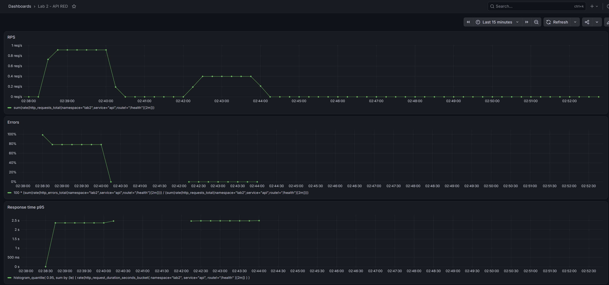
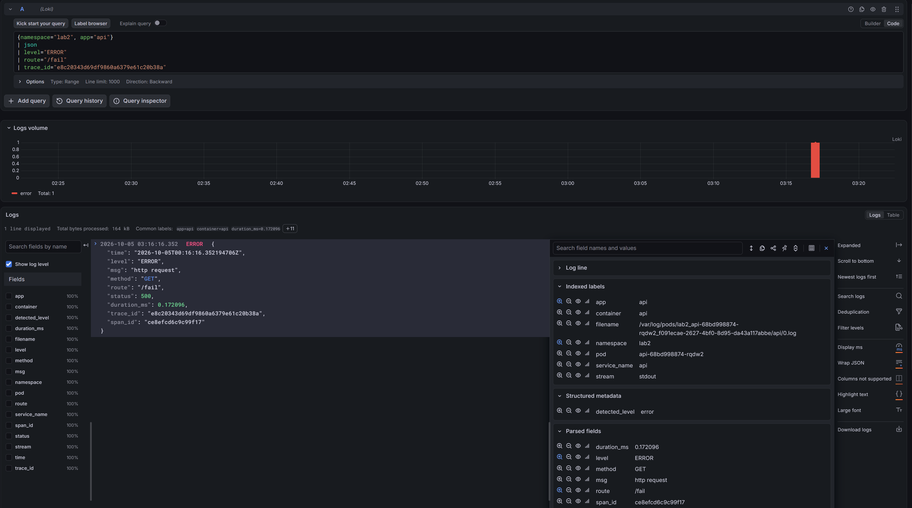
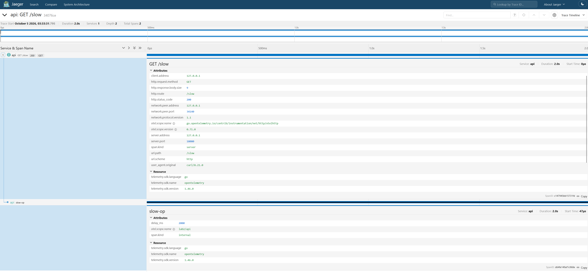
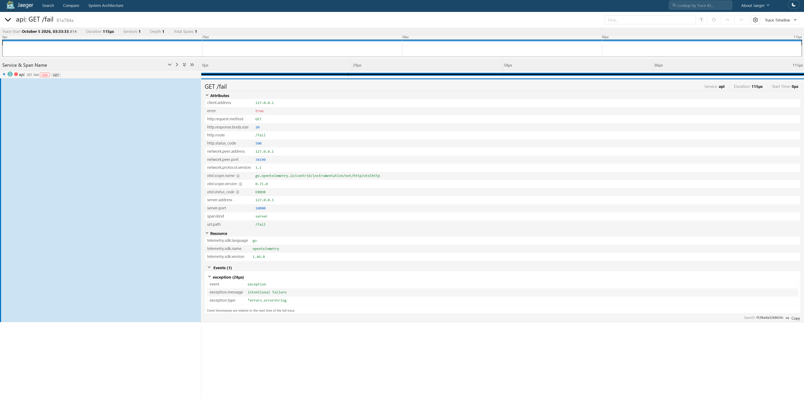
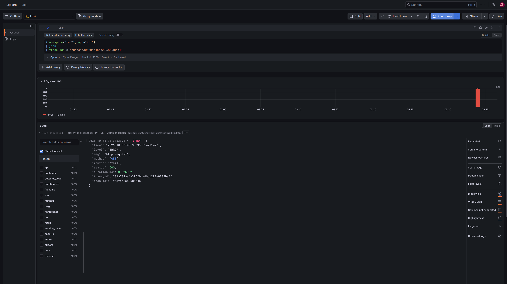
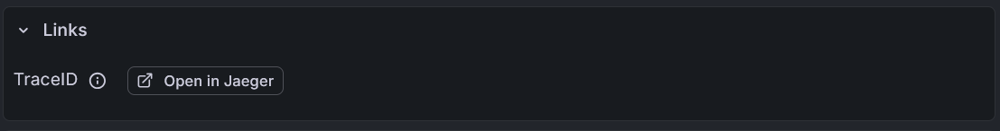
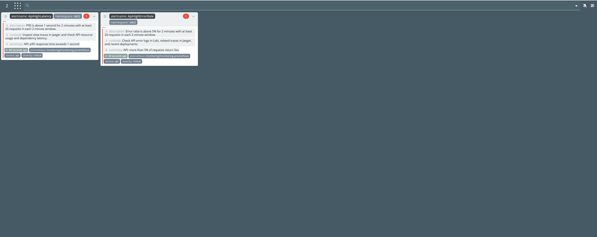
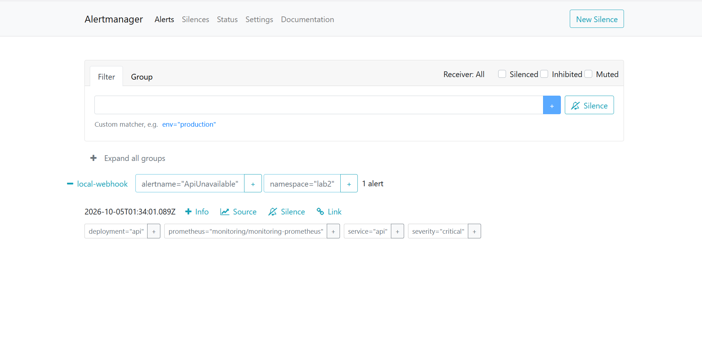
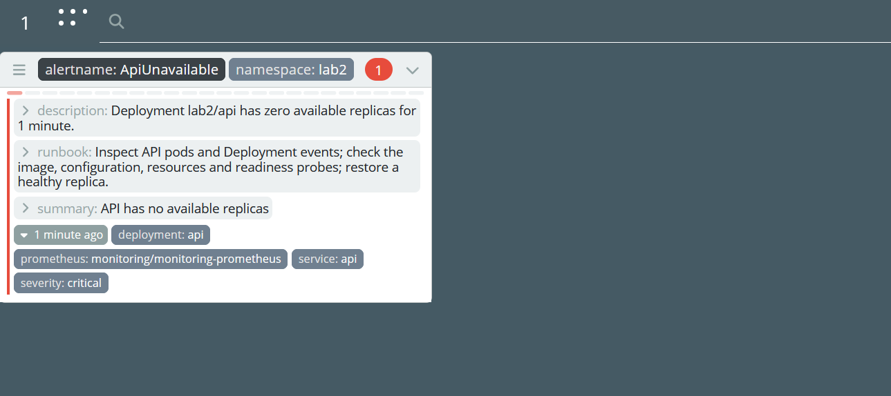

# Лабораторная работа 2 — метрики, логи и трейсы

Для Go-сервиса настроен мониторинг: метрики и логи доступны в Grafana, трейсы — в Jaeger, алерты — в Alertmanager и Karma. Стенд развёрнут в Kubernetes через Helm.

## Стенд и сервис

Стенд работал в Windows: PowerShell, Docker Desktop, kind `lab2` с одним узлом Kubernetes 1.37.0 и Helm 4.3.0. API и мониторинг размещены в пространствах имён `lab2` и `monitoring`.

У [API](api/) есть `/health` с ответом `ok`, `/fail` с ошибкой 500, `/slow` с задержкой две секунды и `/load` для нагрузки на сам сервис. На `/metrics` доступны счётчики запросов и ошибок и гистограмма времени ответа. JSON-логи идут в stdout с полями `trace_id` и `span_id`.

Для запуска в Kubernetes собран Docker-образ API:

```console
lab-2 $ docker build -t lab2-api:0.1 .
[+] Building 50.9s (13/13) FINISHED                       docker:desktop-linux
...
lab-2 $ docker image inspect lab2-api:0.1 --format '{{.Os}}/{{.Architecture}} user={{.Config.User}}'
linux/amd64 user=1000:1000
```

После загрузки образа в kind сервис установлен через [локальный чарт](charts/api/). Для проверки доступа использован `port-forward`:

```console
lab-2 $ helm upgrade --install api ./charts/api --namespace lab2 --create-namespace --kube-context kind-lab2 --wait --timeout 2m
...
STATUS: deployed
...
lab-2 $ kubectl --context kind-lab2 -n lab2 port-forward svc/api 18080:8080
Forwarding from 127.0.0.1:18080 -> 8080
...
apps-orchestration-and-containerization-labs $ curl.exe http://127.0.0.1:18080/health
ok
```

Образ в [чарте](charts/api/values.yaml) — `lab2-api:0.2`. [Dockerfile](api/Dockerfile) лежит в `api/`.

## Метрики: Prometheus и Grafana

Prometheus и Grafana установлены через `prometheus-community/kube-prometheus-stack` 91.8.2. В [настройках](monitoring/values.yaml) заданы постоянные тома, сбор каждые 15 секунд и хранение метрик в течение двух дней.

```console
lab-2 $ helm upgrade --install monitoring $monitoringChart --version $monitoringChartVersion --namespace monitoring --create-namespace --kube-context kind-lab2 --values ./monitoring/values.yaml --wait --timeout 10m
...
STATUS: deployed
...
apps-orchestration-and-containerization-labs $ curl.exe http://127.0.0.1:19090/-/ready
Prometheus Server is Ready.
```

Prometheus собирает `/metrics` через [ServiceMonitor](charts/api/templates/servicemonitor.yaml) с меткой `release=monitoring`. В списке целей API получил статус `up`, поле `lastError` осталось пустым.

В Grafana добавлен [дашборд RED](charts/api/dashboards/api-red.json): RPS, процент ошибок и p95 за последние две минуты. Он загружается из [ConfigMap](charts/api/templates/grafana-dashboard.yaml). `/health` исключён, чтобы проверки Kubernetes не снижали долю ошибок.

При первой проверке процент ошибок оказался выше 100%: ряды счётчиков запросов и ошибок появлялись в разные моменты. Счётчики стали инициализироваться нулём при запуске сервиса. После паузы в 150 секунд повторный тест показал 78,43% — 80 ошибок, 20 медленных ответов и два успешных вызова `/load`.

Задержка проверена через `/slow` и `/load`; `Show-RED` выводил значения из Prometheus:

```console
lab-2 $ curl.exe -sS -w '\ntime_total=%{time_total}s\n' 'http://127.0.0.1:18080/slow'
slept 2s

time_total=2.004884s
lab-2 $ curl.exe -sS 'http://127.0.0.1:18080/load?requests=40&concurrency=20&target=/slow'
{"target":"/slow","requested":40,"completed":40,"succeeded":40,"failed":0}
lab-2 $ Start-Sleep -Seconds 20
lab-2 $ Show-RED | Format-Table -AutoSize
Metric       Value
------       -----
RPS          0.40001523867575917
ErrorPercent 0
P95Seconds   2.4865853658536583
```



## Логи: Loki и Alloy

Логи хранит Loki из чарта `grafana-community/loki` 18.13.7. Он работает в одном процессе с томом 5 GiB — [values.yaml](logging/loki/values.yaml). В Grafana добавлен источник данных с адресом Loki.

Логи собирает Alloy из чарта `grafana/alloy` 1.13.0. Он работает как DaemonSet: читает `/var/log/pods` на каждом узле, разбирает CRI и отправляет записи API в Loki. Правила заданы в [config.alloy](logging/alloy/config.alloy), доступ к файлам — в [values.yaml](logging/alloy/values.yaml).

```console
lab-2 $ helm upgrade --install alloy grafana/alloy `
>   --version $alloyChartVersion `
>   --namespace monitoring `
>   --kube-context kind-lab2 `
>   --values ./logging/alloy/values.yaml `
>   --set-file alloy.configMap.content=./logging/alloy/config.alloy `
>   --wait --timeout 10m
...
STATUS: deployed
...
```

После вызова `/fail` запись об ошибке нашлась в Grafana по запросу `{namespace="lab2", app="api"} | json | level="ERROR" | route="/fail"`. Поле `trace_id` остаётся внутри JSON и не добавляется в индексируемые метки.



## Трейсы: OpenTelemetry и Jaeger

Трейсы принимает Jaeger 2.21.0 из чарта `jaegertracing/jaeger` 4.14.1. В [настройках](tracing/jaeger/values.yaml) выбран Badger с томом 5 GiB и хранением 48 часов. API отправляет все трейсы по OTLP/HTTP на `http://jaeger.monitoring.svc.cluster.local:4318`.

В трейсе `/slow` видно, что почти всё время запроса занимает вложенная операция `slow-op`:



В трейсе `/fail` серверная операция отмечена как ошибочная, а в событиях есть `intentional failure`.



Для проверки связи с логами использован `trace_id` из записи об ошибке: `81a784aa4a306204a4bdd299e0338ba4`.



Кнопка **Open in Jaeger** в Grafana открыла трейс этого запроса:



## Алерты: Alertmanager и Karma

В [PrometheusRule](charts/api/templates/prometheusrule.yaml) настроены три алерта с уровнем `critical`:

- **ApiHighErrorRate**: доля 5xx больше 5% в течение двух минут. Пользователь получает ошибки вместо результата. Дежурному нужно найти ошибочные маршруты в Loki, открыть связанные трейсы и проверить последние изменения.
- **ApiHighLatency**: p95 больше одной секунды в течение двух минут. Пользователь долго ждёт ответ и может столкнуться с таймаутом. Нужно посмотреть медленные операции в Jaeger, ресурсы API и задержки зависимостей.
- **ApiUnavailable**: у Deployment `lab2/api` нет доступных реплик в течение минуты. Запросы некому обслуживать. Нужно проверить поды, события Deployment, образ, настройки и проверки готовности, затем восстановить рабочую реплику.

Алерты на ошибки и задержку исключают `/health` и требуют хотя бы 20 запросов за две минуты. Доступность проверяется по числу доступных реплик Deployment из kube-state-metrics.

Alertmanager группирует уведомления по `namespace` и `alertname` и отправляет их в [приёмник на Go](alert-receiver/). Он установлен из [чарта](charts/alert-receiver/) и пишет уведомления в лог. [Настройка](monitoring/values.yaml) `send_resolved: true` включает сообщения об окончании сбоя.

Первое тестовое уведомление не пришло: Alertmanager ещё использовал стандартную конфигурацию с получателем `null`. Когда загрузилась конфигурация с `local-webhook`, уведомления появились в логах приёмника.

Алерты на ошибки и задержку проверены сначала по отдельности, затем одновременно. Для этого повторялись серии из 80 запросов к `/fail` и 20 к `/slow`:

```console
lab-2 $ Show-ApiAlerts
name             state    health lastError
----             -----    ------ ---------
ApiHighErrorRate firing   ok
ApiHighLatency   firing   ok
ApiUnavailable   inactive ok
```

Уведомления об обоих алертах дошли до приёмника. В его логах появилась запись о `ApiHighLatency`:

```console
lab-2 $ kubectl --context kind-lab2 -n monitoring logs deployment/alert-receiver --tail=10 |
>   Select-String 'ApiHighLatency'
{"time":"2026-10-05T01:14:46.086442172Z",...,"msg":"alert notification received","notification":{"alerts":[{...,"labels":{"alertname":"ApiHighLatency",...},...,"status":"firing"}],...,"receiver":"local-webhook",...}}
```

Karma из чарта `wiremind/karma` 2.13.1 показывает алерты из Alertmanager и обновляется каждые 15 секунд — [values.yaml](alerting/karma/values.yaml). Во время проверки оба алерта появились в Alertmanager и Karma:




Для проверки `ApiUnavailable` число реплик API уменьшено до нуля:

```console
lab-2 $ helm upgrade api ./charts/api `
>   --namespace lab2 --kube-context kind-lab2 `
>   --values ./charts/api/values.yaml --set replicaCount=0 `
>   --wait --timeout 3m
...
lab-2 $ kubectl --context kind-lab2 -n lab2 get deployment api
NAME   READY   UP-TO-DATE   AVAILABLE   AGE
api    0/0     0            0           3d4h
lab-2 $ Show-ApiAlerts
name             state    health lastError
----             -----    ------ ---------
ApiHighErrorRate inactive ok
ApiHighLatency   inactive ok
ApiUnavailable   firing   ok
```




