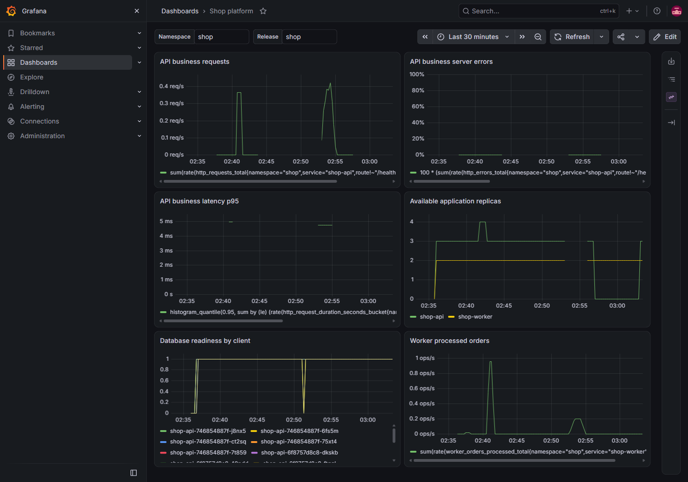
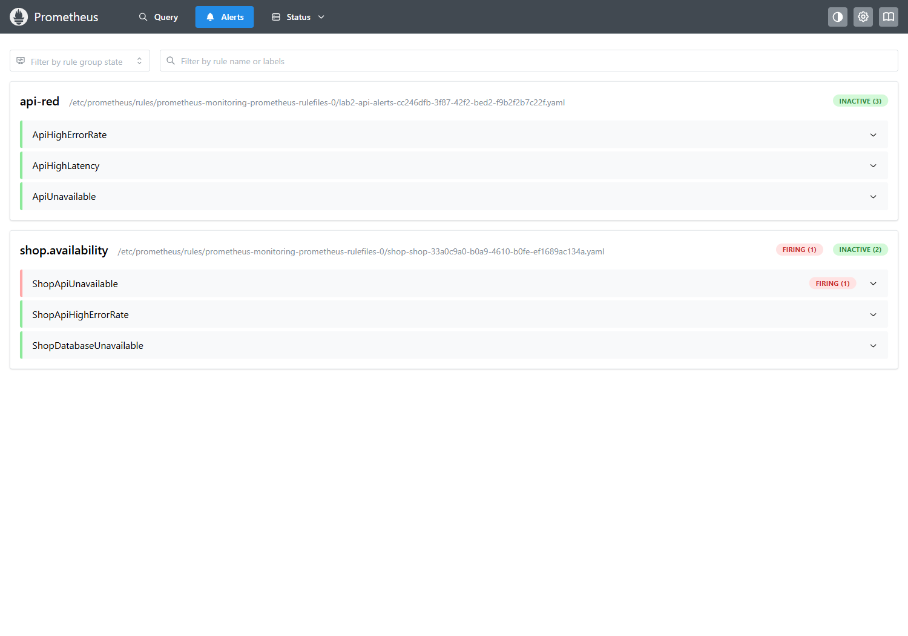

# Лабораторная работа 3 — платформа для shop

Лаба выполнялась в kind `lab2`. Команды — из корня репозитория (`repo $`), `...` — сокращение вывода.

## 0. Сервисы

[Сервисы](services/) — Go, [Dockerfile](services/Dockerfile) общий.

## 1. Правила для подов

Выбран Gatekeeper: на Rego можно проверить разные типы контейнеров. [Политики](policies/) применяются ко всем прикладным подам.

1. **Ресурсы.** Requests и limits позволяют спланировать и ограничить расход процессора и памяти. Limits убраны:

   ```console
   repo $ kubectl --context kind-lab2 create --dry-run=server -f lab-3/policies/invalid/01-missing-resources.yaml
   ... [lab3-require-resources] containers test must set resources.limits.cpu
   ...
   ```

2. **Образы.** Разрешены `registry.lab.local/shop/` и `ghcr.io/cloudnative-pg/`. Образ из Docker Hub не прошёл:

   ```console
   repo $ kubectl --context kind-lab2 create --dry-run=server -f lab-3/policies/invalid/02-untrusted-image.yaml
   ... [lab3-trusted-images] ... must use an allowed prefix: ...
   ```

3. **Метки.** Помогают различать приложения и релизы. Удалена `app.kubernetes.io/name`:

   ```console
   repo $ kubectl --context kind-lab2 create --dry-run=server -f lab-3/policies/invalid/03-missing-labels.yaml
   ... [lab3-require-labels] Pod must have a non-empty label app.kubernetes.io/name
   ```

4. **Привилегии.** `privileged` запрещён, чтобы сохранить изоляцию. Под с `privileged: true` отклонён:

   ```console
   repo $ kubectl --context kind-lab2 create --dry-run=server -f lab-3/policies/invalid/04-privileged.yaml
   ... [lab3-no-privileged] containers test must not be privileged
   ```

5. **Окружение узла.** Запрещены `hostNetwork`, `hostPID`, `hostIPC`. Под с `hostNetwork: true` не прошёл:

   ```console
   repo $ kubectl --context kind-lab2 create --dry-run=server -f lab-3/policies/invalid/05-host-namespaces.yaml
   ... [lab3-no-host-namespaces] Pod must not enable hostNetwork
   ```

При запуске Gatekeeper системные запросы тоже блокировались. Помогли [исключения для инфраструктуры](platform/gatekeeper-values.yaml).

## 2. Helm-чарт

[Чарт](charts/shop/) запускает 3 пода API и 2 worker. Готовность и работоспособность проверяются через `/health`. Установка прошла:

```console
repo $ helm install shop lab-3/charts/shop --kube-context kind-lab2 -n shop --wait --timeout 5m
...
STATUS: deployed
REVISION: 1
...
```

Удалённый API-под заменён ReplicaSet. Изменение [values.yaml](charts/shop/values.yaml) и `helm upgrade` дали 4/4, затем 3/3.

При смене образа `0.1.0 → 0.2.0` все 1182 запроса к `/health` прошли. С `maxUnavailable: 0`, `maxSurge: 1` оставались 3 доступных пода и добавлялся один новый.

С `api.healthFail=true` новый под отвечал 503, обновление застряло. Старые поды обслужили 2956 запросов без ошибок. Откат вернул 3 рабочие реплики:

```console
repo $ kubectl --context kind-lab2 -n shop rollout status deployment/shop-api --timeout=10s
error: deployment "shop-api" exceeded its progress deadline
repo $ helm rollback shop 4 --kube-context kind-lab2 -n shop --wait --timeout 90s
Rollback was a success! Happy Helming!
```

## 3. PostgreSQL через оператор

CloudNativePG установлен в `cnpg-system`. Чарт создаёт [Cluster](charts/shop/templates/database.yaml) с диском 1 GiB. Удалённый `shop-db-1` восстановился за три минуты, 51 заказ остался на прежнем PVC.

```console
repo $ kubectl --context kind-lab2 -n shop get cluster shop-db -o yaml
...
spec:
  ...
  instances: 1
  ...
status:
  ...
  phase: Cluster in healthy state
  ...
```

`spec` задаёт требования, `status` показывает результат. Обычные контроллеры `kube-controller-manager` следят за подами, оператор ещё и знает, как восстанавливать PostgreSQL.

## 4. Остановка API server

На 100 секунд убран манифест API server. Проверка изоляции CNPG отключена, чтобы единственная база не остановилась вслед за ним. Команды внутри узла выполнял временный скрипт; ниже — основные команды и сохранённый вывод. `node / #` обозначает оболочку узла kind.

```console
node / # mv /etc/kubernetes/manifests/kube-apiserver.yaml /var/tmp/lab3-kube-apiserver.yaml
node / # crictl stop --timeout 5 545de5ced4db51046e6b33fc667b096e542496353d6b7e7fd1708acfc9aa2c5b
545de5ced4db51046e6b33fc667b096e542496353d6b7e7fd1708acfc9aa2c5b
```

`kubectl apply` и Helm не могли применить изменения:

```console
repo $ helm upgrade shop lab-3/charts/shop --kube-context kind-lab2 -n shop --wait --timeout 10s
Error: UPGRADE FAILED: kubernetes cluster unreachable: ... EOF
```

При этом API и worker продолжали отвечать, чтение из БД работало:

```console
node / # curl -fsS --max-time 5 -w '\nhttp_status=%{http_code}\n' http://10.96.242.138:8080/health
ok

http_status=200
node / # curl -fsS --max-time 5 -w '\nhttp_status=%{http_code}\n' http://10.96.196.2:8080/health
ok

http_status=200
node / # curl -fsS --max-time 5 -w '\nhttp_status=%{http_code}\n' http://10.96.242.138:8080/orders
[{"id":51,"item":"concurrent-lab3","quantity":1,"status":"processed", ...}, ...]

http_status=200
```

За время остановки прошли 100 GET-проверок, 20 заказов и 2462 запроса `/health` без ошибок.

Манифест возвращён, управление восстановилось:

```console
node / # mv /var/tmp/lab3-kube-apiserver.yaml /etc/kubernetes/manifests/kube-apiserver.yaml
repo $ kubectl --context kind-lab2 --request-timeout=10s get nodes -o wide
NAME                 STATUS   ROLES           AGE   VERSION   ...
lab2-control-plane   Ready    control-plane   10d   v1.37.0   ...
```

После восстановления все 20 новых заказов имели статус `processed`.

## 5. Мониторинг

[ServiceMonitor](charts/shop/templates/servicemonitor.yaml) добавил пять доступных целей в Prometheus второй лабы.



Три [правила](charts/shop/templates/prometheusrule.yaml), каждое ждёт 30 секунд:

1. `ShopApiUnavailable` — нет доступных реплик API.
2. `ShopApiHighErrorRate` — более 5% ответов 5xx при минимум 20 бизнес-запросах за минуту, без `/health`.
3. `ShopDatabaseUnavailable` — БД недоступна всем наблюдаемым клиентам.

При 0 реплик API алерт сработал (`firing`), получатель второй лабы принял уведомление.



Helm сохранил временные 0 реплик; помог `--reset-values` с файлом values. После экспериментов работали 3 API и 2 worker, все 71 заказ обработаны. [Замеры](results.json).

