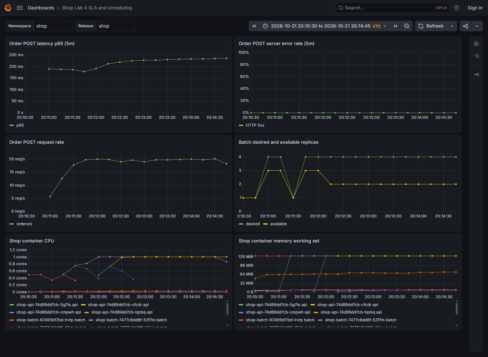
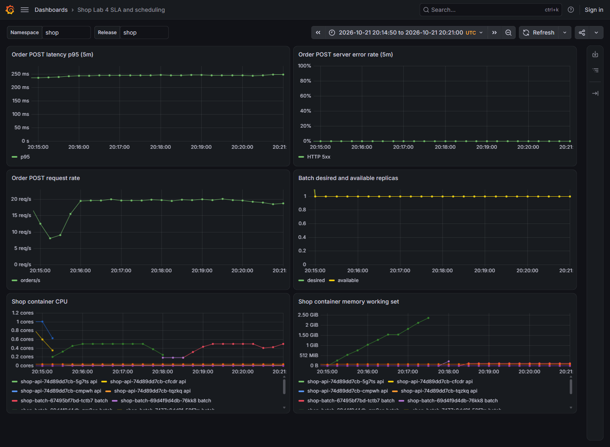
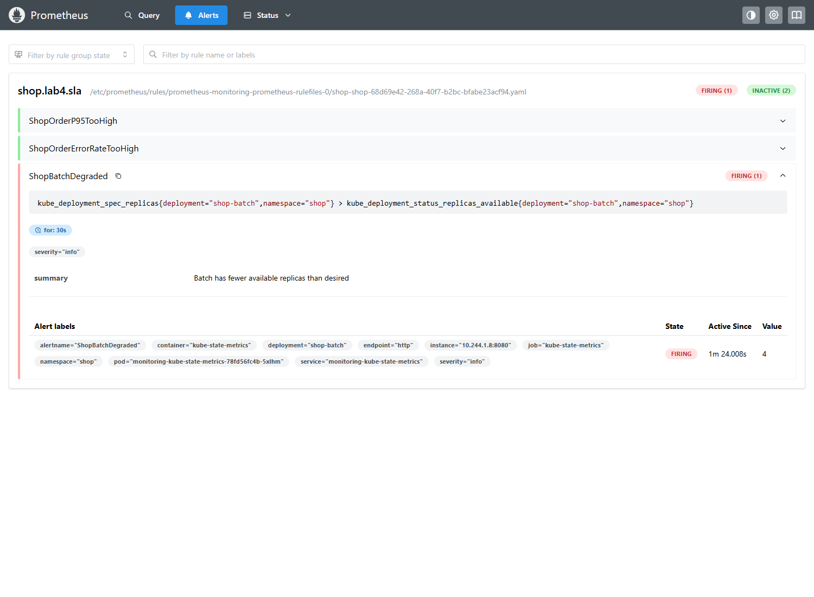

# Лабораторная №4. SLA при нехватке ресурсов

Цель: проверить, что API и PostgreSQL продолжают обрабатывать заказы при нехватке CPU и памяти. Batch создаёт фоновую нагрузку. У него низкий приоритет, поэтому его можно вытеснить первым. [Задание](https://github.com/KeladKaal/containerization-and-orchestration/blob/main-rus/lecture-4-scheduling-resources/lab.md).

За основу взяты [сервисы](../lab-3/services/) и [политики Gatekeeper](../lab-3/policies/) из lab-3. В [чарт shop](charts/shop/) добавлены batch, размещение API на разных узлах, приоритеты, PDB и мониторинг.

## Batch и стенд

[Batch](batch/main.go) в цикле вычисляет SHA-256 и постепенно занимает память. CPU_WORKERS задаёт число горутин, которые нагружают CPU. MEMORY_MIB задаёт нужный объём памяти, а MEMORY_STEP_MIB определяет, сколько MiB добавляется за секунду. Batch записывает данные в память и не освобождает её, чтобы создать нагрузку. [Dockerfile](batch/Dockerfile) собирает программу и запускает её от пользователя 10001.

```console
PS .> docker build -t registry.lab.local/shop/batch:0.1.0 lab-4/batch
...
#10 naming to registry.lab.local/shop/batch:0.1.0 done
#10 DONE 0.7s
PS .> docker image inspect registry.lab.local/shop/batch:0.1.0 --format '{{.Os}}/{{.Architecture}} user={{.Config.User}}'
linux/amd64 user=10001:10001
PS .> kind create cluster --name lab4 --config lab-4/kind.yaml --image kindest/node:v1.37.0 --wait 120s
...
Set kubectl context to "kind-lab4"
```

В [kind.yaml](kind.yaml) заданы два узла: control-plane и worker. Поды приложения могут работать на обоих. Docker Desktop предоставляет 32 CPU и около 30 GiB памяти. Через systemReserved подам оставлено примерно 3 CPU и 3 GiB на узел. Так проще получить нехватку ресурсов.

Порог eviction равен 256 MiB. Настройка enforceNodeAllocatable: [pods] позволяет kubelet [вытеснять поды при превышении общего бюджета памяти](https://kubernetes.io/docs/tasks/administer-cluster/reserve-compute-resources/#enforcing-node-allocatable).

```console
PS .> kubectl --context kind-lab4 get nodes -o custom-columns='NAME:.metadata.name,CPU:.status.allocatable.cpu,MEMORY:.status.allocatable.memory,TAINTS:.spec.taints'
NAME                 CPU   MEMORY      TAINTS
lab4-control-plane   3     3025012Ki   <none>
lab4-worker          3     3025012Ki   <none>
PS .> kind load docker-image registry.lab.local/shop/api:0.2.0 registry.lab.local/shop/worker:0.1.0 registry.lab.local/shop/batch:0.1.0 --name lab4
...
PS .> helm upgrade --install shop lab-4/charts/shop --kube-context kind-lab4 -n shop --create-namespace --wait --timeout 5m
Release "shop" does not exist. Installing it now.
...
```

Установлены CloudNativePG 1.29.3, Gatekeeper 3.23.1 и kube-prometheus-stack 91.8.2. Мониторинг использует [values из lab-2](../lab-2/monitoring/values.yaml) с [настройками для этой работы](platform/monitoring-values.yaml). После запуска Gatekeeper применены политики из lab-3.

Batch держал в памяти 128 MiB данных и потреблял около 0,5 CPU при лимите 500m. Запрос к /health вернул код 200:

```console
PS .> kubectl --context kind-lab4 -n shop logs deployment/shop-batch --tail=3
2026/10/21 19:53:52 batch allocated_mib=128 target_mib=128 cpu_workers=1
2026/10/21 19:53:53 batch allocated_mib=128 target_mib=128 cpu_workers=1
2026/10/21 19:53:54 batch allocated_mib=128 target_mib=128 cpu_workers=1
PS .> docker exec lab4-control-plane curl -fsS -w 'http_status=%{http_code}\n' http://10.96.206.173:8080/health
ok
http_status=200
```

Для проверки из копии манифеста batch убран resources.limits. Gatekeeper отклонил такой под при запуске команды с --dry-run=server:

```console
PS .> kubectl --context kind-lab4 create --dry-run=server -f 'C:\Users\jexu\AppData\Local\Temp\lab4-20261021-223455\batch-no-limits.json'
Error from server (Forbidden): ...
admission webhook "validation.gatekeeper.sh" denied the request:
[lab3-require-resources] containers batch must set resources.limits.cpu
[lab3-require-resources] containers batch must set resources.limits.memory
```

Политики работают и для batch. Его рабочий шаблон содержит requests, limits, обязательные метки и настройки securityContext.

## Размещение подов, приоритеты и PDB

Параметр api.placement.mode в [values.yaml](charts/shop/values.yaml) выбирает способ размещения API: topologySpreadConstraints или podAntiAffinity. Оба варианта добавлены в [шаблон Deployment](charts/shop/templates/deployments.yaml).

Выбран topologySpreadConstraints с maxSkew: 1 и minDomains: 2. Он размещает три реплики на двух узлах так, чтобы разница была не больше одного пода. Если условие нарушается, DoNotSchedule запрещает запуск нового пода на этом узле.

У podAntiAffinity задано мягкое правило. При строгом запрете соседства на двух узлах поместились бы только две реплики API. Поэтому для трёх реплик удобнее topologySpreadConstraints.

В результате два API-пода работают на control-plane, один на worker. При отказе одного узла на другом останется API. Однако база запущена в одном экземпляре, поэтому её отказ всё ещё остановит обработку заказов.

Проверка размещения и PDB после обновления ресурсов:

```console
PS .> kubectl --context kind-lab4 -n shop get pods -o wide
NAME                           READY   STATUS    RESTARTS   ...   NODE
shop-api-74d89dd7cb-5g7ts      1/1     Running   0          ...   lab4-control-plane
shop-api-74d89dd7cb-cfcdr      1/1     Running   0          ...   lab4-worker
shop-api-74d89dd7cb-tqzkq      1/1     Running   0          ...   lab4-control-plane
...
PS .> kubectl --context kind-lab4 -n shop get pdb
NAME              MIN AVAILABLE   MAX UNAVAILABLE   ALLOWED DISRUPTIONS   ...
shop-api          2               N/A               1                     ...
shop-db-primary   1               N/A               0                     ...
```

В [PriorityClass](charts/shop/templates/priorityclasses.yaml) для API и PostgreSQL задан приоритет 100000, для batch задан -1000. У API и базы requests равны limits по CPU и памяти, поэтому их класс QoS называется Guaranteed.

Batch запрашивает 50m CPU и 64Mi памяти. Его лимиты равны 500m и 512Mi. Requests ниже limits, поэтому batch получил класс Burstable.

```console
PS .> kubectl --context kind-lab4 -n shop get pods -o custom-columns='NAME:.metadata.name,QOS:.status.qosClass,PRIORITY:.spec.priority,CLASS:.spec.priorityClassName'
NAME                           QOS          PRIORITY   CLASS
shop-api-74d89dd7cb-5g7ts      Guaranteed   100000     shop-critical
shop-api-74d89dd7cb-cfcdr      Guaranteed   100000     shop-critical
shop-api-74d89dd7cb-tqzkq      Guaranteed   100000     shop-critical
shop-batch-67495bf7bd-tctb7    Burstable    -1000      shop-batch
...
shop-db-1                      Guaranteed   100000     shop-critical
...
```

[PDB API](charts/shop/templates/pdb.yaml) требует оставлять минимум две доступные реплики при плановом выселении подов. PDB базы создаёт CloudNativePG по параметру enablePDB в [шаблоне Cluster](charts/shop/templates/database.yaml). Он запрещает плановое выселение единственной реплики PostgreSQL. Эти ограничения не защищают от отказа узла, нехватки памяти или прямого удаления пода.

При preemption планировщик может освободить место для важного пода за счёт подов с меньшим приоритетом. При нехватке памяти решение принимает kubelet. Он сначала выбирает поды, которые превысили requests, затем сравнивает их приоритеты и объём превышения. Batch расходует больше памяти, чем запросил, и имеет низкий приоритет. Поэтому он вытесняется раньше API и базы. Класс Guaranteed снижает риск вытеснения, но не исключает его полностью.

## Нагрузка и рекомендации KRR

Нагрузку создавал hey 0.1.4. Он работал внутри узла kind и отправлял запросы на ClusterIP сервиса API с [данными заказа](load/order.json). Четыре клиента с q=5 дают около 20 запросов в секунду. Keep-alive отключён, чтобы новые соединения могли попадать на разные реплики.

```console
PS .> docker exec lab4-control-plane sh -c `
> 'date -u; hey -z 3m -c 4 -q 5 -disable-keepalive -m POST -T application/json -D /var/tmp/lab4-order.json http://10.96.3.77:8080/order | tee /var/tmp/lab4-baseline.txt; date -u'
Wed Oct 21 20:02:18 UTC 2026
...
Summary:
  Total:        180.0101 secs
  Average:      0.0063 secs
  Requests/sec: 19.9989
...
Latency distribution:
  ...
  95% in 0.0087 secs
...
Status code distribution:
  [201] 3600 responses
```

Для KRR 1.31.1 задана история за час с шагом в одну минуту:

```console
PS .> & 'C:\Users\jexu\AppData\Local\Temp\lab4-20261021-223455\krr-runtime\krr\krr.exe' simple `
> --context kind-lab4 --namespace shop --resource Deployment `
> --prometheus-url http://127.0.0.1:29090 --history-duration 1 `
> --timeframe-duration 1 --points-required 10 --formatter json `
> --fileoutput 'C:\Users\jexu\Documents\projects\labs\apps-orchestration-and-containerization-labs\lab-4\krr-report.json' `
> 2>&1 | Tee-Object -FilePath 'C:\Users\jexu\AppData\Local\Temp\lab4-20261021-223455\krr-scan.log'
...
```

В [отчёте KRR](krr-report.json) для API и worker рекомендованы request 10m CPU и 100Mi памяти. Лимит памяти тоже равен 100Mi, а лимит CPU предложено убрать. Для расчёта были доступны десять минут метрик.

Ресурсы изменены так:

- API: requests и limits снижены с 500m / 256Mi до 10m / 100Mi.
- Worker: requests снижены с 100m / 128Mi до 10m / 100Mi. Limits изменены с 500m / 256Mi на 500m / 100Mi.
- PostgreSQL: requests и limits снижены с 500m / 256Mi до 31m / 100Mi по расчёту ниже.

При 20 заказах в секунду приложению нужно меньше ресурсов, чем было задано сначала. Убрать CPU limits нельзя из-за политики Gatekeeper. Для API лимит CPU сделан равным request, чтобы получить Guaranteed. Для worker оставлен лимит 500m.

KRR [не поддерживает CloudNativePG Cluster](https://github.com/robusta-dev/krr/issues/542), поэтому PostgreSQL не попал в его отчёт. Для базы взяты метрики из Prometheus и применены те же правила расчёта:

- CPU: p95 минутного потребления с округлением вверх до 1m. Минимум 10m.
- Память: максимальное потребление с запасом 15% и округлением вверх до MiB. Минимум 100Mi.

```console
PS .> curl.exe -fsS -G `
> --data-urlencode 'query=clamp_min(ceil(1000*max(quantile_over_time(0.95,(max by(pod,container,job)(rate(container_cpu_usage_seconds_total{namespace="shop",pod="shop-db-1",container="postgres"}[1m])))[1h:1m])))/1000,0.01)' http://127.0.0.1:29090/api/v1/query
{"status":"success","data":{"resultType":"vector","result":[{"metric":{},"value":[...,"0.031"]}]}}
PS .> curl.exe -fsS -G `
> --data-urlencode 'query=clamp_min(ceil(max(max_over_time(container_memory_working_set_bytes{namespace="shop",pod="shop-db-1",container="postgres"}[1h]))*1.15/1048576),100)' http://127.0.0.1:29090/api/v1/query
{"status":"success","data":{"resultType":"vector","result":[{"metric":{},"value":[...,"100"]}]}}
PS .> helm upgrade shop lab-4/charts/shop --kube-context kind-lab4 -n shop --wait --timeout 5m
Release "shop" has been upgraded. Happy Helming!
...
STATUS: deployed
REVISION: 2
DESCRIPTION: Upgrade complete
```

После обновления PostgreSQL перезапустился. Проверки SLA начались, когда база снова была готова принимать запросы.

## Pending и preemption

Для batch в values.yaml задан CPU request 1274m и limit 3. Request и limit памяти остались 64Mi и 512Mi. Число реплик увеличено до четырёх.

При первой попытке ресурсы и число реплик изменены одновременно. Из-за этого RollingUpdate остановился: старый под занимал место, нужное новому. Поэтому сначала обновлена одна реплика, затем их число снова увеличено до четырёх. Три пода запустились, четвёртый остался в Pending:

```console
PS .> helm upgrade shop lab-4/charts/shop --kube-context kind-lab4 -n shop
Release "shop" has been upgraded. Happy Helming!
...
REVISION: 5
PS .> kubectl --context kind-lab4 -n shop get pods -l app.kubernetes.io/name=batch -o wide
NAME                          READY   STATUS    ...   NODE
shop-batch-7477c8dd8f-52f7m   1/1     Running   ...   lab4-worker
shop-batch-7477c8dd8f-h7dxb   0/1     Pending   ...   <none>
shop-batch-7477c8dd8f-kj5mx   1/1     Running   ...   lab4-control-plane
shop-batch-7477c8dd8f-kvhr7   1/1     Running   ...   lab4-worker
PS .> kubectl --context kind-lab4 -n shop describe pod shop-batch-7477c8dd8f-h7dxb
...
QoS Class: Burstable
...
Warning  FailedScheduling  ...  0/2 nodes are available: 2 Insufficient cpu.
preemption: 0/2 nodes are available: 2 No preemption victims found for incoming pod.
```

При размещении планировщик учитывает requests. По requests на worker оставался только 1m CPU. Затем в values.yaml число реплик API увеличено с трёх до четырёх, а настройки применены через Helm. По правилу topologySpreadConstraints новый под должен был попасть на worker. Для его request 10m места уже не хватало.

```console
PS .> helm upgrade shop lab-4/charts/shop --kube-context kind-lab4 -n shop
Release "shop" has been upgraded. Happy Helming!
...
REVISION: 6
PS .> kubectl --context kind-lab4 -n shop get events --field-selector reason=Preempted
LAST SEEN   TYPE     REASON      OBJECT                            MESSAGE
31s         Normal   Preempted   pod/shop-batch-7477c8dd8f-kvhr7   Preempted by pod 5acad7a1-49fc-4810-a036-6f587b365bfa on node lab4-worker
PS .> kubectl --context kind-lab4 -n shop get pod shop-api-74d89dd7cb-cmpwh -o jsonpath='{.metadata.uid}{"\n"}{.status.phase}{"\n"}'
5acad7a1-49fc-4810-a036-6f587b365bfa
Running
```

В событии указан UID нового пода API. Значит, планировщик вытеснил batch, чтобы освободить место для API. После этого работали четыре API-пода и два batch-пода. Ещё два batch оставались в Pending.

## Нехватка памяти

В values.yaml снова заданы три реплики API и одна batch. Для batch установлен MEMORY_MIB=3072: он занимал память со скоростью 16 MiB/с. Request памяти остался 64Mi, limit увеличен до 4Gi. При таких настройках общая память подов должна закончиться раньше, чем batch достигнет своего лимита.

```console
PS .> helm upgrade shop lab-4/charts/shop --kube-context kind-lab4 -n shop --wait --timeout 2m
Release "shop" has been upgraded. Happy Helming!
...
REVISION: 7
PS .> kubectl --context kind-lab4 -n shop logs deployment/shop-batch --tail=3
2026/10/21 20:17:32 batch allocated_mib=2576 target_mib=3072 cpu_workers=1
2026/10/21 20:17:33 batch allocated_mib=2592 target_mib=3072 cpu_workers=1
2026/10/21 20:17:34 batch allocated_mib=2608 target_mib=3072 cpu_workers=1
PS .> kubectl --context kind-lab4 -n shop get events --field-selector reason=Evicted --sort-by=.lastTimestamp
LAST SEEN   TYPE      REASON    OBJECT                            MESSAGE
10s         Warning   Evicted   pod/shop-batch-69d4f9d4db-zm9cn   The node was low on resource: memory. Threshold quantity: 256Mi, available: 122924Ki. Container batch was using 2483256Ki, request is 64Mi, has larger consumption of memory.
PS .> docker exec lab4-worker journalctl -u kubelet --since '2026-10-21 20:17:00 UTC' --no-pager -n 25
...
Oct 21 20:17:37 ... "Eviction manager: pods ranked for eviction" pods=["shop/shop-batch-69d4f9d4db-zm9cn",...,"shop/shop-db-1","shop/shop-api-74d89dd7cb-cfcdr",...]
...
Oct 21 20:17:37 ... "Eviction manager: pod is evicted successfully" pod="shop/shop-batch-69d4f9d4db-zm9cn"
...
```

Kubelet первым выбрал batch для вытеснения. В этот момент batch потреблял около 2,37 GiB при лимите 4 GiB. Deployment создал вместо него новый под с суффиксом 76kk8. Три пода API и shop-db-1 продолжили работать без пересоздания и перезапусков.

```console
PS .> kubectl --context kind-lab4 -n shop get pods -o wide
NAME                           READY   STATUS      RESTARTS   ...   NODE
shop-api-74d89dd7cb-5g7ts      1/1     Running     0          ...   lab4-control-plane
shop-api-74d89dd7cb-cfcdr      1/1     Running     0          ...   lab4-worker
shop-api-74d89dd7cb-tqzkq      1/1     Running     0          ...   lab4-control-plane
shop-batch-69d4f9d4db-76kk8    1/1     Running     0          ...   lab4-worker
shop-batch-69d4f9d4db-zm9cn    0/1     Completed   0          ...   lab4-worker
shop-db-1                      1/1     Running     0          ...   lab4-worker
...
```

Batch завершился с кодом 0 и получил статус Completed. В событии и журнале kubelet указана причина Evicted. Записи OOMKilled нет.

Если бы контейнер превысил свой лимит памяти, он мог бы завершиться с OOMKilled и кодом 137. Тогда kubelet перезапустил бы контейнер в том же поде. Здесь закончилась память, выделенная подам на узле. Kubelet вытеснил batch целиком, а Deployment создал новый под. API и PostgreSQL с высоким приоритетом и классом Guaranteed продолжили работать.

В 20:18:06 UTC через Helm возвращены исходные настройки batch: одна реплика, 128 MiB данных, request 50m / 64Mi, limit 500m / 512Mi. После этого память перестала заполняться.

## SLA и мониторинг

SLA для каждой проверки: p95 оформления заказа меньше 300 мс, ошибок меньше 1%. Пока менялись настройки batch, hey продолжал отправлять заказы.

Во время preemption hey работал четыре минуты с прежними параметрами нагрузки:

```console
PS .> docker exec lab4-control-plane sh -c `
> 'date -u; hey -z 4m -c 4 -q 5 -disable-keepalive -m POST -T application/json -D /var/tmp/lab4-order.json http://10.96.3.77:8080/order | tee /var/tmp/lab4-preemption.txt; date -u'
Wed Oct 21 20:10:33 UTC 2026
...
Summary:
  Total:        240.2792 secs
  Requests/sec: 19.7728
...
  95% in 0.2004 secs
  99% in 0.3598 secs
...
Status code distribution:
  [201] 4751 responses
...
Wed Oct 21 20:14:33 UTC 2026
```

При preemption SLA выполнен: p95 составил 200,4 мс, ошибок нет. Самый медленный запрос занял 1,1769 с. На графике видно, что доступных реплик batch стало меньше. При этом p95 остался ниже 300 мс.



Во время опыта с памятью hey работал шесть минут:

```console
PS .> docker exec lab4-control-plane sh -c `
> 'date -u; hey -z 6m -c 4 -q 5 -disable-keepalive -m POST -T application/json -D /var/tmp/lab4-order.json http://10.96.3.77:8080/order | tee /var/tmp/lab4-eviction.txt; date -u'
Wed Oct 21 20:14:58 UTC 2026
...
Summary:
  Total:        360.1342 secs
  Requests/sec: 19.5316
...
  95% in 0.2604 secs
  99% in 0.4000 secs
...
Status code distribution:
  [201] 7034 responses
...
Wed Oct 21 20:20:58 UTC 2026
```

SLA за эту проверку выполнен: p95 составил 260,4 мс, ошибок нет. Самый медленный запрос занял 1,3586 с.

На графике batch занимает всё больше памяти. Около 20:17:37 UTC линия обрывается, потому что под вытеснен. В 20:18:06 возвращены исходные настройки batch. На графике доступных реплик падения нет: новый под появился примерно за секунду, между двумя сборами метрик.



В Prometheus p95 за пять минут достигал 248,4 мс. При расчёте за одну минуту были пики около 410 мс.

[ServiceMonitor](charts/shop/templates/servicemonitor.yaml) собирает метрики API и worker. На [дашборде](charts/shop/dashboards/shop.json) показаны p95, доля ошибок 5xx, запросы в секунду, доступность batch, CPU и память. Дашборд загружается через [ConfigMap](charts/shop/templates/dashboard.yaml).

На графиках указано время UTC. Prometheus оценивает p95 по гистограмме за последние пять минут. Hey считает его по всем запросам за время проверки, поэтому значения могут отличаться.

В [PrometheusRule](charts/shop/templates/prometheusrule.yaml) три алерта:

- ShopOrderP95TooHigh сообщает, что p95 превысил 300 мс и заказы обрабатываются слишком долго.
- ShopOrderErrorRateTooHigh сообщает, что доля ответов 5xx превысила 1%.
- ShopBatchDegraded сообщает, что доступных реплик batch меньше, чем задано в Deployment.

Алерт срабатывает, если условие сохраняется 30 секунд. Во время опыта с Pending и preemption сработал ShopBatchDegraded:

```console
PS .> curl.exe -fsS http://127.0.0.1:29090/api/v1/alerts
{"status":"success","data":{"alerts":[{
  "labels":{"alertname":"ShopBatchDegraded",...},
  ...
  "state":"firing",
  "activeAt":"2026-10-21T20:12:02.887932352Z",
  "value":"4e+00"
}]}}
```



После опытов восстановлены три реплики API и одна batch. Ресурсы API, worker и PostgreSQL оставлены по результатам KRR и расчёта. Helm lint прошёл без ошибок. Манифесты собрались для обоих способов размещения API. Все Deployment готовы, PostgreSQL работает.

```console
PS .> helm lint lab-4/charts/shop --strict
==> Linting lab-4/charts/shop
[INFO] Chart.yaml: icon is recommended

1 chart(s) linted, 0 chart(s) failed
PS .> kubectl --context kind-lab4 -n shop get deployment
NAME          READY   UP-TO-DATE   AVAILABLE   AGE
shop-api      3/3     3            3           27m
shop-batch    1/1     1            1           27m
shop-worker   2/2     2            2           27m
PS .> kubectl --context kind-lab4 -n shop get cluster shop-db
NAME      AGE   INSTANCES   READY   STATUS                     PRIMARY
shop-db   27m   1           1       Cluster in healthy state   shop-db-1
```


