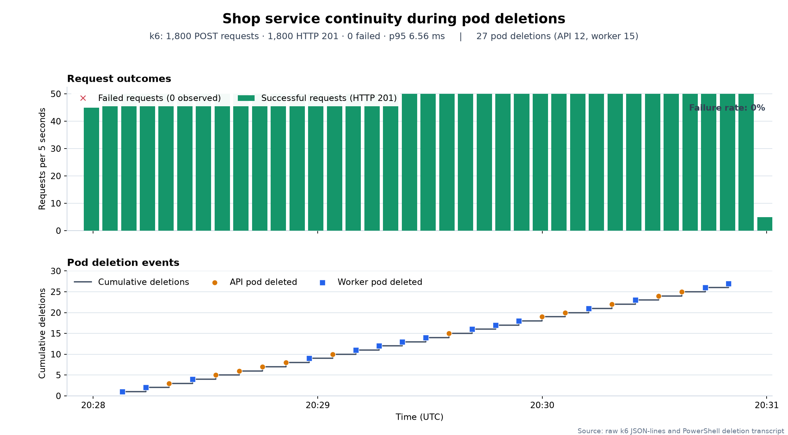
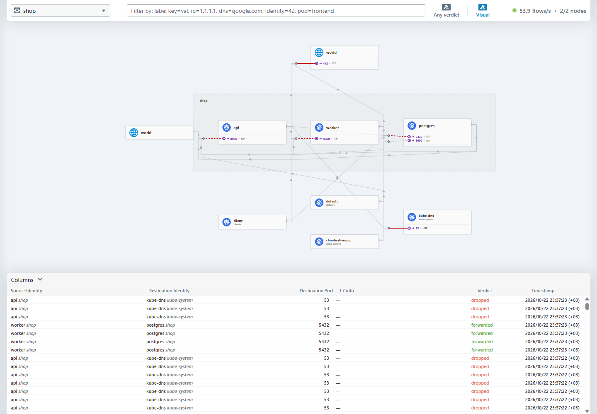
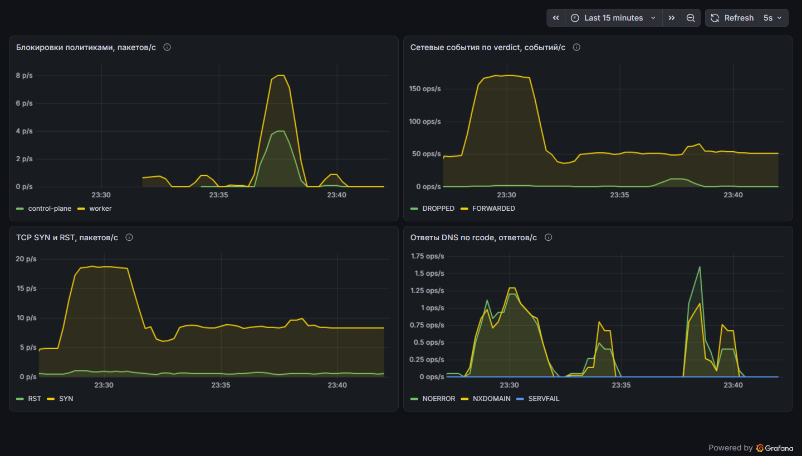

# Лабораторная №5. Сетевая изоляция shop

Цель: проверить работу Service при постоянном пересоздании подов, ограничить доступ к приложению через NetworkPolicy и найти сетевую неисправность по событиям Hubble.

Использованы [api и worker из lab-3](../lab-3/services/) и PostgreSQL под управлением CloudNativePG. В [чарт shop](charts/shop/) добавлены сетевые политики и мониторинг. Batch для этой работы не нужен.

## 0. Выбор CNI и запуск стенда

Выбран Cilium 1.20.3. Он применяет NetworkPolicy и предоставляет Hubble, где видны отправитель, получатель, порт и причина блокировки. Стандартный kindnet не обеспечивает нужную проверку политик.

В [kind.yaml](kind.yaml) отключён стандартный CNI. Созданы два узла без taint на control-plane. Диапазон адресов подов: `10.245.0.0/16`, сервисов: `10.97.0.0/16`. Cilium использует Kubernetes IPAM. Замена kube-proxy отключена, поэтому обработку Service можно проверить отдельно от политик Cilium.

```console
PS apps-orchestration-and-containerization-labs> kind create cluster --name lab5 `
> --config lab-5/kind.yaml --image kindest/node:v1.37.0
PS apps-orchestration-and-containerization-labs> helm install cilium cilium/cilium `
> --version 1.20.3 --kube-context kind-lab5 -n kube-system `
> -f lab-5/platform/cilium-values.yaml --wait --timeout 5m
PS apps-orchestration-and-containerization-labs> helm install cnpg cnpg/cloudnative-pg `
> --version 0.29.1 --kube-context kind-lab5 -n cnpg-system `
> --create-namespace --wait --timeout 3m
PS apps-orchestration-and-containerization-labs> helm install shop lab-5/charts/shop `
> --kube-context kind-lab5 -n shop --create-namespace --wait --timeout 4m
```

При загрузке локальных образов через `kind load docker-image` возникла ошибка отсутствующего digest. Образы сохранены для `linux/amd64` и загружены архивом:

```console
PS apps-orchestration-and-containerization-labs> docker image save --platform linux/amd64 `
> -o "$env:TEMP\lab5-20261022-231321\shop-images.tar" `
> registry.lab.local/shop/api:0.2.0 registry.lab.local/shop/worker:0.1.0
PS apps-orchestration-and-containerization-labs> kind load image-archive `
> "$env:TEMP\lab5-20261022-231321\shop-images.tar" --name lab5
```

После загрузки работают три реплики API, две worker и один PostgreSQL. API и worker имеют requests `50m/64Mi`, limits `500m/256Mi`. Для базы заданы requests `100m/256Mi`, limits `1 CPU/512Mi`. Проверка готовности приложения использует `/ready`, который учитывает доступность базы. `/health` проверяет сам процесс. На первом этапе `networkPolicy.enabled` был равен `false`. Политики включены после проверки общей сети и нагрузки.

## 1. Сеть пода и связь между узлами

У API-пода `shop-api-59f9d897bb-gm6qz` на control-plane проверены интерфейс и индекс парного интерфейса:

```console
PS apps-orchestration-and-containerization-labs> kubectl --context kind-lab5 -n shop `
> exec shop-api-59f9d897bb-gm6qz -- ip -o address show eth0
20: eth0    inet 10.245.0.51/32 scope global eth0\       valid_lft forever preferred_lft forever
...
PS apps-orchestration-and-containerization-labs> kubectl --context kind-lab5 -n shop `
> exec shop-api-59f9d897bb-gm6qz -- cat /sys/class/net/eth0/iflink
21
PS apps-orchestration-and-containerization-labs> docker exec lab5-control-plane ip -o link
...
21: lxc960088822c49@if20: <BROADCAST,MULTICAST,UP,LOWER_UP> mtu 1500 ...
```

`eth0` находится в сетевом namespace пода. Его парный veth с индексом 21 находится на узле. При создании pod sandbox kubelet через CRI вызывает настройку сети CNI. Cilium назначает адрес и настраивает интерфейсы, маршруты и обработку пакетов. Адрес `/32` здесь не означает отсутствие связи с другими подами: дальнейший путь пакета определяется маршрутами и Cilium.

С этого пода выполнен запрос к API на другом узле, напрямую по Pod IP:

```console
PS apps-orchestration-and-containerization-labs> kubectl --context kind-lab5 -n shop `
> exec shop-api-59f9d897bb-gm6qz -- wget -qO- http://10.245.1.228:8080/health
ok
```

Получатель `shop-api-59f9d897bb-rmvrw` работал на `lab5-worker`. Ответ подтверждает связь между узлами по адресам подов до включения политик. Для этого запроса Service не использовался.

## 2. Нагрузка и постоянное удаление подов

API опубликован через NodePort `30080`, который в kind проброшен на `localhost:30085`:

```console
PS apps-orchestration-and-containerization-labs> kubectl --context kind-lab5 -n shop `
> get svc shop-api shop-db-rw
NAME         TYPE        CLUSTER-IP     EXTERNAL-IP   PORT(S)          AGE
shop-api     NodePort    10.97.244.21   <none>        8080:30080/TCP   2m5s
shop-db-rw   ClusterIP   10.97.50.156   <none>        5432/TCP         2m5s
PS apps-orchestration-and-containerization-labs> curl.exe -fsS http://localhost:30085/health
ok
```

NodePort открывает порт на узлах и направляет трафик к Service. LoadBalancer дополнительно требует внешний балансировщик от облачного провайдера или отдельной реализации. Headless Service с `clusterIP: None` возвращает в DNS адреса конечных подов. Выбор адреса и обработка его смены тогда остаются клиенту.

Для нагрузки использован pod `load-client` в namespace `clients` с меткой `app=client`. Клиент k6 описан в [client.yaml](load/client.yaml). ConfigMap `load-script` содержит [order.js](load/order.js), смонтированный как `/script/order.js`. Скрипт отправляет 10 POST-запросов в секунду в течение трёх минут. Для каждого запроса открывается новое HTTP-соединение.

```console
PS apps-orchestration-and-containerization-labs> kubectl --context kind-lab5 create namespace clients
PS apps-orchestration-and-containerization-labs> kubectl --context kind-lab5 -n clients `
> create configmap load-script --from-file=lab-5/load/order.js
PS apps-orchestration-and-containerization-labs> kubectl --context kind-lab5 `
> apply -f lab-5/load/client.yaml
pod/load-client configured
```

k6 обращался к `http://shop-api.shop.svc.cluster.local:8080/order`. Это DNS-имя Service с ClusterIP. Доступ через NodePort проверен отдельно командой `curl` выше.

Параллельно запущен [kill-pods.ps1](chaos/kill-pods.ps1). Он выбирает случайный готовый API или worker, удаляет его обычным `kubectl delete` и ждёт шесть секунд. Работа ограничена 165 секундами.

```console
PS apps-orchestration-and-containerization-labs> .\lab-5\chaos\kill-pods.ps1 `
> -DurationSeconds 165 -IntervalSeconds 6
...
2026-10-22T20:28:20.2962798Z deleted=shop-api-59f9d897bb-rmvrw ip=10.245.1.228 node=lab5-worker
...
2026-10-22T20:28:32.7835230Z deleted=shop-api-59f9d897bb-gm6qz ip=10.245.0.51 node=lab5-control-plane
...
2026-10-22T20:30:49.7596131Z deleted=shop-worker-56c745b57-wgjwj ip=10.245.0.150 node=lab5-control-plane
...
```

За время теста удалено 27 подов: 12 API и 15 worker. Новые экземпляры получали другие IP. Результат k6:

```console
PS apps-orchestration-and-containerization-labs> kubectl --context kind-lab5 -n clients `
> exec load-client -- k6 run --out json=/tmp/chaos.json /script/order.js
...
    checks_total.......................: 1800    10.00042/s
    checks_succeeded...................: 100.00% 1800 out of 1800
    checks_failed......................: 0.00%   0 out of 1800
...
    http_req_duration.......................................................: avg=4.84ms min=3.54ms med=4.18ms max=37.9ms  p(90)=5.94ms p(95)=6.55ms
...
    http_req_failed.........................................................: 0.00%  0 out of 1800
    http_reqs...............................................................: 1800   10.00042/s
...
    dropped_iterations......................................................: 0      0/s
...
```

Все 1800 запросов получили HTTP 201. На графике сопоставлены результаты запросов и удаления подов. p95 на графике округлён из исходного значения до 6,56 мс, в кратком выводе k6 показано 6,55 мс.



До нагрузки EndpointSlice содержал исходные адреса API:

```console
PS apps-orchestration-and-containerization-labs> kubectl --context kind-lab5 -n shop `
> get endpointslice -l kubernetes.io/service-name=shop-api
NAME             ADDRESSTYPE   PORTS   ENDPOINTS                               AGE
shop-api-bwrtc   IPv4          8080    10.245.1.221,10.245.0.51,10.245.1.228   2m5s
```

После удалений все три адреса изменились:

```console
PS apps-orchestration-and-containerization-labs> kubectl --context kind-lab5 -n shop `
> get endpointslice -l kubernetes.io/service-name=shop-api
NAME             ADDRESSTYPE   PORTS   ENDPOINTS                               AGE
shop-api-bwrtc   IPv4          8080    10.245.1.30,10.245.1.154,10.245.0.136   5m53s
```

Режим kube-proxy проверен по журналу:

```console
PS apps-orchestration-and-containerization-labs> kubectl --context kind-lab5 -n kube-system `
> logs daemonset/kube-proxy --tail=40
...
I1022 20:22:23.639692       1 server_linux.go:144] "Using iptables Proxier"
...
```

DNS возвращает стабильный ClusterIP Service. Контроллер EndpointSlice обновляет список адресов подов и их готовность. kube-proxy следит за Service и EndpointSlice, затем обновляет правила iptables, которые выбирают готовую конечную точку для нового соединения. Сам процесс kube-proxy не проксирует каждый HTTP-запрос.

Три реплики API оставляют готовые экземпляры во время удаления одного пода. `/ready` не включает в балансировку экземпляр без базы. `preStop` задерживает завершение на пять секунд, после чего приложение завершает работу штатно. Это уменьшает окно между удалением конечной точки и остановкой сервера. PDB не защищает от прямого `delete pod`, поэтому результат обеспечен репликами и завершением приложения, а не запретом удаления.

В этом стенде kube-proxy использует iptables. IPVS использует другой механизм выбора сервера и поддерживает разные алгоритмы балансировки. Различие заметнее при большом числе сервисов и конечных точек, когда важны стоимость обновления правил и поведение балансировки. DNS-имя и модель Service от режима не меняются. Нулевое число ошибок получено в этом тесте с обычным удалением подов; принудительное завершение процесса или потеря узла здесь не проверялись.

## 3. Целевая матрица доступа

Для namespace `shop` задан запрет входящих и исходящих соединений по умолчанию. Разрешены только следующие направления:

- Клиент с `app=client` из `clients` к API, TCP 8080.
- Внешний клиент к API через NodePort 30080, внутри пода TCP 8080.
- API к PostgreSQL, TCP 5432.
- Worker к PostgreSQL, TCP 5432.
- API, worker и PostgreSQL к CoreDNS в `kube-system`, UDP и TCP 53.
- PostgreSQL к Kubernetes API `172.19.0.5`, TCP 6443. Это нужно instance manager CloudNativePG.
- Оператор CloudNativePG из `cnpg-system` к instance manager PostgreSQL, TCP 8000.
- Узел мониторинга lab-2 `172.19.0.2` к worker через NodePort 30081, внутри пода TCP 8080.

Остальные направления запрещены: случайный pod к любому компоненту shop, клиент напрямую к базе и worker, API к worker, worker к API, база к приложению и выход API или worker в интернет. Ответы на разрешённые соединения обслуживаются состоянием соединения, отдельное разрешение обратного потока не нужно.

Hubble на узлах lab-5 и экспорт метрик CoreDNS доступны существующему мониторингу lab-2 отдельно от HTTP-интерфейсов приложения.

## 4. NetworkPolicy в Helm

Политики находятся в [networkpolicies.yaml](charts/shop/templates/networkpolicies.yaml). Метки участников, порты и внешние CIDR задаются через [values.yaml](charts/shop/values.yaml). Шаблон создаёт default-deny, DNS, вход в API, вход мониторинга в worker, два разрешения исходящих соединений к базе и правило для PostgreSQL.

В DNS-правиле namespaceSelector и podSelector находятся в одном элементе: разрешение относится именно к подам `k8s-app=kube-dns` в `kube-system`. Правила базы ограничены меткой текущего Helm release. Внешний доступ к API разрешён через `0.0.0.0/0`; в Cilium такой CIDR не включает идентичности подов кластера. Поэтому случайный pod не получает доступ к API через это разрешение.

В `values.yaml` включён `networkPolicy.enabled`, затем обновлён release:

```console
PS apps-orchestration-and-containerization-labs> helm upgrade shop lab-5/charts/shop `
> --kube-context kind-lab5 -n shop --wait --timeout 2m
```

При первой проверке PostgreSQL не смог подключиться к Kubernetes API, хотя CIDR адреса узла был указан в правиле. Причина в том, что Cilium по умолчанию не сопоставляет идентичности узлов с CIDR-селекторами. В [cilium-values.yaml](platform/cilium-values.yaml) включён `policyCIDRMatchMode: [nodes]`. Адрес API в правиле ограничен `172.19.0.5/32`. После обновления Helm агенты Cilium перезапущены, чтобы применить настройку.

```console
PS apps-orchestration-and-containerization-labs> helm upgrade cilium cilium/cilium `
> --version 1.20.3 --kube-context kind-lab5 -n kube-system `
> -f lab-5/platform/cilium-values.yaml --wait --timeout 3m
PS apps-orchestration-and-containerization-labs> kubectl --context kind-lab5 -n kube-system `
> rollout restart daemonset/cilium
PS apps-orchestration-and-containerization-labs> kubectl --context kind-lab5 -n kube-system `
> rollout status daemonset/cilium --timeout=120s
PS containerization-and-orchestration> kubectl --context kind-lab5 -n shop `
> exec shop-db-1 -c netcheck -- nc -zvw2 172.19.0.5 6443
172.19.0.5 (172.19.0.5:6443) open
```

После исправления база снова имеет статус `Cluster in healthy state`. Worker использует `externalTrafficPolicy: Local`, чтобы сохранить адрес внешнего источника для проверки CIDR мониторинга. У API используется `Cluster`, поэтому внешний запрос может попасть на готовую реплику другого узла.

## 5. Проверка матрицы

Для проверок из базы и оператора использованы диагностические контейнеры `netcheck` и `netprobe` в тех же подах. Они имеют тот же сетевой namespace и подпадают под те же NetworkPolicy. После исправления скрытой ошибки повторены разрешённые и запрещённые соединения.

Основные разрешённые соединения:

```console
PS containerization-and-orchestration> kubectl --context kind-lab5 -n shop `
> exec deployment/shop-api -- nc -zvw2 shop-db-rw 5432
shop-db-rw (10.97.50.156:5432) open
PS containerization-and-orchestration> kubectl --context kind-lab5 -n shop `
> exec deployment/shop-worker -- nc -zvw2 shop-db-rw 5432
shop-db-rw (10.97.50.156:5432) open
PS containerization-and-orchestration> kubectl --context kind-lab5 -n cnpg-system `
> exec cnpg-cloudnative-pg-7b5f5d7b65-4ftg2 -c netprobe -- nc -zvw2 10.245.1.248 8000
10.245.1.248 (10.245.1.248:8000) open
PS containerization-and-orchestration> kubectl --context kind-lab5 -n clients `
> exec load-client -- wget -qO- http://shop-api.shop.svc.cluster.local:8080/health
ok
```

DNS проверен из каждого компонента shop:

```console
PS containerization-and-orchestration> kubectl --context kind-lab5 -n shop `
> exec deployment/shop-api -- nslookup shop-db-rw.shop.svc.cluster.local
...
Name:	shop-db-rw.shop.svc.cluster.local
Address: 10.97.50.156
PS containerization-and-orchestration> kubectl --context kind-lab5 -n shop `
> exec deployment/shop-worker -- nslookup shop-db-rw.shop.svc.cluster.local
...
Name:	shop-db-rw.shop.svc.cluster.local
Address: 10.97.50.156
PS containerization-and-orchestration> kubectl --context kind-lab5 -n shop `
> exec shop-db-1 -c netcheck -- nslookup kubernetes.default.svc.cluster.local
...
Name:	kubernetes.default.svc.cluster.local
Address: 10.97.0.1
```

Ожидаемый и фактический результат разрешённых направлений совпали:

- `client` к API: разрешено; `/health` вернул `ok`.
- Внешний клиент к API: разрешено; POST `/order` создал заказ 1804, затем статус стал `processed`.
- API к PostgreSQL: разрешено; TCP 5432 открыт.
- Worker к PostgreSQL: разрешено; TCP 5432 открыт.
- API к DNS: разрешено; имя базы разрешилось в `10.97.50.156`.
- Worker к DNS: разрешено; имя базы разрешилось в `10.97.50.156`.
- PostgreSQL к DNS: разрешено; имя Kubernetes API разрешилось в `10.97.0.1`.
- PostgreSQL к Kubernetes API: разрешено; TCP 6443 открыт.
- Оператор CloudNativePG к PostgreSQL: разрешено; TCP 8000 открыт.
- Узел lab-2 к worker: разрешено; `/metrics` вернул `database_ready 1` и `worker_errors_total 0`.

Для проверки постороннего клиента создан pod `stray` в namespace `default`:

```console
PS apps-orchestration-and-containerization-labs> kubectl --context kind-lab5 -n default `
> run stray --image=alpine:3.23 --restart=Never --command -- sleep 7200
PS apps-orchestration-and-containerization-labs> kubectl --context kind-lab5 -n default `
> wait --for=condition=Ready pod/stray --timeout=90s
```

Запрещённые направления проверены новыми TCP-соединениями с таймаутом две секунды:

```console
PS containerization-and-orchestration> kubectl --context kind-lab5 -n default `
> exec stray -- nc -zvw2 shop-db-rw.shop.svc.cluster.local 5432
nc: shop-db-rw.shop.svc.cluster.local (10.97.50.156:5432): Operation timed out
command terminated with exit code 1
PS containerization-and-orchestration> kubectl --context kind-lab5 -n default `
> exec stray -- nc -zvw2 shop-api.shop.svc.cluster.local 8080
nc: shop-api.shop.svc.cluster.local (10.97.244.21:8080): Operation timed out
command terminated with exit code 1
PS containerization-and-orchestration> kubectl --context kind-lab5 -n default `
> exec stray -- nc -zvw2 shop-worker.shop.svc.cluster.local 8080
nc: shop-worker.shop.svc.cluster.local (10.97.184.121:8080): Operation timed out
command terminated with exit code 1
PS containerization-and-orchestration> kubectl --context kind-lab5 -n clients `
> exec load-client -- nc -zvw2 shop-db-rw.shop.svc.cluster.local 5432
nc: shop-db-rw.shop.svc.cluster.local (10.97.50.156:5432): Operation timed out
command terminated with exit code 1
PS containerization-and-orchestration> kubectl --context kind-lab5 -n clients `
> exec load-client -- nc -zvw2 shop-worker.shop.svc.cluster.local 8080
nc: shop-worker.shop.svc.cluster.local (10.97.184.121:8080): Operation timed out
command terminated with exit code 1
PS containerization-and-orchestration> kubectl --context kind-lab5 -n shop `
> exec deployment/shop-api -- nc -zvw2 shop-worker 8080
nc: shop-worker (10.97.184.121:8080): Operation timed out
command terminated with exit code 1
PS containerization-and-orchestration> kubectl --context kind-lab5 -n shop `
> exec deployment/shop-worker -- nc -zvw2 shop-api 8080
nc: shop-api (10.97.244.21:8080): Operation timed out
command terminated with exit code 1
PS containerization-and-orchestration> kubectl --context kind-lab5 -n shop `
> exec deployment/shop-api -- nc -zvw2 1.1.1.1 443
nc: 1.1.1.1 (1.1.1.1:443): Operation timed out
command terminated with exit code 1
PS containerization-and-orchestration> kubectl --context kind-lab5 -n shop `
> exec deployment/shop-worker -- nc -zvw2 1.1.1.1 443
nc: 1.1.1.1 (1.1.1.1:443): Operation timed out
command terminated with exit code 1
PS containerization-and-orchestration> kubectl --context kind-lab5 -n shop `
> exec shop-db-1 -c netcheck -- nc -zvw2 shop-api 8080
nc: shop-api (10.97.244.21:8080): Operation timed out
command terminated with exit code 1
PS containerization-and-orchestration> kubectl --context kind-lab5 -n shop `
> exec shop-db-1 -c netcheck -- nc -zvw2 shop-worker 8080
nc: shop-worker (10.97.184.121:8080): Operation timed out
command terminated with exit code 1
```

Каждая из этих проверок завершилась `Operation timed out`, код возврата 1. Итог запрещённой части матрицы:

- `stray` к PostgreSQL: запрещено; таймаут.
- `stray` к API: запрещено; таймаут.
- `stray` к worker: запрещено; таймаут.
- `client` к PostgreSQL: запрещено; таймаут.
- `client` к worker: запрещено; таймаут.
- API к worker: запрещено; таймаут.
- Worker к API: запрещено; таймаут.
- API к `1.1.1.1:443`: запрещено; таймаут.
- Worker к `1.1.1.1:443`: запрещено; таймаут.
- PostgreSQL к API: запрещено; таймаут.
- PostgreSQL к worker: запрещено; таймаут.

Случайный pod не может подключиться к базе, а оба нужных клиента базы подключаются. Проверка целого заказа дополнительно подтверждает работу API, PostgreSQL и worker вместе.

## 6. Поиск скрытой неисправности

[break-network.ps1](chaos/break-network.ps1) выбирает одну из четырёх ошибок: DNS-порт 54, порт базы 5433 для API, порт базы 5433 для worker или неверную метку API в разрешении входа в базу. Скрипт применяет изменение через Helm values и не печатает выбранный вариант.

```console
PS apps-orchestration-and-containerization-labs> .\lab-5\chaos\break-network.ps1
2026-10-22T20:34:47.4149180Z network fault applied to release=shop namespace=shop
```

Первые заказы после изменения продолжили проходить: 1802 и 1803 получили HTTP 201 и были обработаны worker. При этом новые подключения по имени базы уже не работали:

```console
PS containerization-and-orchestration> kubectl --context kind-lab5 -n shop `
> exec deployment/shop-api -- nc -zvw2 shop-db-rw 5432
nc: bad address 'shop-db-rw'
command terminated with exit code 1
PS containerization-and-orchestration> kubectl --context kind-lab5 -n shop `
> exec deployment/shop-worker -- nc -zvw2 shop-db-rw 5432
nc: bad address 'shop-db-rw'
command terminated with exit code 1
```

`bad address` указывает на этап разрешения имени. Для отделения DNS от доступа к базе проверено прямое подключение к IP PostgreSQL:

```console
PS containerization-and-orchestration> kubectl --context kind-lab5 -n shop `
> exec deployment/shop-api -- nc -zvw3 10.245.1.248 5432
10.245.1.248 (10.245.1.248:5432) open
PS containerization-and-orchestration> kubectl --context kind-lab5 -n kube-system `
> exec cilium-lqh5v -- hubble observe --since 2m --namespace shop `
> --protocol UDP --verdict DROPPED --last 8
Oct 22 20:35:02.907: shop/shop-api-59f9d897bb-vsqkc:46058 (ID:41727) <> kube-system/coredns-559f6c778d-mbwlr:53 (ID:65497) policy-verdict:none EGRESS DENIED (UDP)
Oct 22 20:35:02.907: shop/shop-api-59f9d897bb-vsqkc:46058 (ID:41727) <> kube-system/coredns-559f6c778d-mbwlr:53 (ID:65497) Policy denied DROPPED (UDP)
...
```

Hubble показал блокировку исходящего UDP-трафика от API к CoreDNS на порту 53. Проверка действующего правила выявила разрешение порта 54:

```console
PS containerization-and-orchestration> kubectl --context kind-lab5 -n shop `
> get networkpolicy shop-allow-dns -o yaml
...
    - port: 54
      protocol: UDP
    - port: 54
      protocol: TCP
...
```

Несовпадение портов объясняет и ошибку имени, и успешное подключение к IP базы.



Существующие SQL-соединения маскировали сбой: для них повторный DNS-запрос не нужен. Чтобы проверить поведение нового экземпляра приложения, удалены все API-поды. После этого свежие процессы не смогли установить соединения с базой, `/ready` возвращал 503, все API стали `0/1`.

```console
PS containerization-and-orchestration> kubectl --context kind-lab5 -n shop `
> delete pod -l app.kubernetes.io/name=api --wait=false
PS containerization-and-orchestration> curl.exe -sS --max-time 5 `
> -H 'Content-Type: application/json' -d '{"item":"after-reconnect","quantity":1}' `
> -w '\nhttp=%{http_code}\n' http://localhost:30085/order
curl: (52) Empty reply from server
http=000
PS containerization-and-orchestration> kubectl --context kind-lab5 -n shop `
> get pods -l app.kubernetes.io/name=api
NAME                        READY   STATUS    RESTARTS   AGE
shop-api-59f9d897bb-497mf   0/1     Running   0          15s
shop-api-59f9d897bb-bvd45   0/1     Running   0          15s
shop-api-59f9d897bb-t7plr   0/1     Running   0          15s
```

Исправление выполнено обновлением release с `--reset-values`: восстановлены значения файла, где DNS-порт равен 53. Это убрало ошибочное переопределение, сохранённое предыдущим Helm upgrade.

```console
PS apps-orchestration-and-containerization-labs> helm upgrade shop lab-5/charts/shop `
> --kube-context kind-lab5 -n shop --reset-values --wait --timeout 2m
...
STATUS: deployed
...
REVISION: 5
...
PS apps-orchestration-and-containerization-labs> kubectl --context kind-lab5 -n shop `
> get networkpolicy shop-allow-dns -o jsonpath='{.spec.egress[0].ports}{"\n"}'
[{"port":53,"protocol":"UDP"},{"port":53,"protocol":"TCP"}]
PS apps-orchestration-and-containerization-labs> curl.exe -fsS --max-time 5 `
> -H 'Content-Type: application/json' -d '{"item":"after-fix","quantity":1}' `
> http://localhost:30085/order
{"id":1804,"item":"after-fix","quantity":1,"status":"pending","created_at":"2026-10-22T20:37:56.478347Z"}
PS containerization-and-orchestration> curl.exe -fsS http://localhost:30085/orders `
> | ConvertFrom-Json | Where-Object item -eq 'after-fix'
id           : 1804
item         : after-fix
quantity     : 1
status       : processed
created_at   : 22.10.2026 20:37:56
processed_at : 22.10.2026 20:37:57
```

Все три API снова стали `1/1 Ready`. Повторные проверки матрицы из предыдущего раздела подтвердили восстановление разрешённых соединений и сохранение запретов.

## 7. Мониторинг и алерты

Использован существующий Prometheus и Grafana из lab-2. Новый стек в lab-5 не устанавливался. Тот же чарт установлен вторым release `shop-network` в namespace `monitoring` кластера lab-2: `workloads.enabled=false`, `monitoring.enabled=true`. Так ServiceMonitor, PrometheusRule и ConfigMap дашборда находятся рядом с существующим Prometheus, а приложение остаётся в lab-5.

```console
PS apps-orchestration-and-containerization-labs> kubectl --context kind-lab5 -n kube-system `
> scale deployment coredns --replicas=1
PS apps-orchestration-and-containerization-labs> kubectl --context kind-lab5 `
> apply -f lab-5/platform/coredns-metrics.yaml
PS apps-orchestration-and-containerization-labs> helm install shop-network lab-5/charts/shop `
> --kube-context kind-lab2 -n monitoring --set workloads.enabled=false `
> --set monitoring.enabled=true --wait --timeout 2m
```

[Шаблон мониторинга](charts/shop/templates/monitoring.yaml) создаёт Services без selector и EndpointSlice с адресами узлов lab-5. Hubble опрашивается на обоих узлах, CoreDNS через [NodePort 30953](platform/coredns-metrics.yaml). У CoreDNS оставлена одна реплика, чтобы запросы через NodePort не чередовали счётчики разных процессов.

Проверка активных целей Prometheus:

```console
PS containerization-and-orchestration> curl.exe -fsS http://127.0.0.1:39090/api/v1/targets `
> | ConvertFrom-Json | Select-Object -ExpandProperty data `
> | Select-Object -ExpandProperty activeTargets `
> | Where-Object {$_.labels.cluster -eq 'lab5'} `
> | Select-Object scrapeUrl,health,lastError
scrapeUrl : http://172.19.0.6:9965/metrics
health    : up
lastError :

scrapeUrl : http://172.19.0.5:9965/metrics
health    : up
lastError :

scrapeUrl : http://172.19.0.5:30953/metrics
health    : up
lastError :
```

Отдельно проверен доступ узла lab-2 к worker. Это подтверждает разрешение в матрице; текущий ServiceMonitor опрашивает Hubble и CoreDNS.

```console
PS containerization-and-orchestration> docker exec lab2-control-plane `
> curl -fsS --max-time 5 http://172.19.0.5:30081/metrics
...
database_ready 1
...
worker_errors_total 0
...
worker_orders_processed_total 11
```

[Дашборд](charts/shop/dashboards/network.json) показывает блокировки политиками, события Hubble по verdict, TCP SYN/RST и ответы DNS по rcode. Во всех запросах стоит `cluster="lab5"`. Счётчики Hubble отражают наблюдаемые сетевые события и пакеты, поэтому их нельзя считать точным количеством уникальных HTTP-запросов или соединений.



На дашборде и в Hubble UI время указано по Москве (UTC+3). На графике нагрузки и в выводе `hubble observe` используется UTC. Всплеск блокировок около 23:37 соответствует неисправности DNS в 20:37 UTC.

В PrometheusRule добавлены три алерта с выдержкой 30 секунд:

- `Lab5NetworkPolicyDrops`: `sum(rate(hubble_drop_total{cluster="lab5",reason="POLICY_DENIED"}[1m])) > 0.1`. Показывает постоянную блокировку политиками и сработал при ошибке DNS-порта.
- `Lab5TCPResetRatio`: отношение скорости RST к SYN больше 0,5 при скорости SYN больше 0,1/с. Помогает заметить частые сбросы. Порог SYN исключает деление на почти нулевой поток. Это эвристика сетевого состояния, а не вероятность неуспешного запроса.
- `Lab5DNSErrors`: скорость ответов CoreDNS с `SERVFAIL` или `REFUSED` больше нуля. Помогает обнаружить ошибки самого DNS-сервера. При блокировке пакета до CoreDNS сервер ответа не выдаёт, поэтому такой таймаут обнаруживает первый алерт.

Во время неисправности `Lab5NetworkPolicyDrops` перешёл из `pending` в `firing`:

```console
PS containerization-and-orchestration> curl.exe -fsS http://127.0.0.1:39090/api/v1/alerts `
> | ConvertFrom-Json | Select-Object -ExpandProperty data `
> | Select-Object -ExpandProperty alerts `
> | Where-Object {$_.labels.cluster -eq 'lab5'} | ConvertTo-Json -Depth 6
{
  "labels": {
    "alertname": "Lab5NetworkPolicyDrops",
    "cluster": "lab5",
    "severity": "warning"
  },
  ...
  "state": "firing",
  "activeAt": "2026-10-22T20:36:36.581813796Z",
  "value": "9.228515644952363e+00"
}
```

Итоговый чарт прошёл `helm lint --strict`. Манифесты обоих release проверены через `kubectl apply --dry-run=server` в соответствующих кластерах. API имеет три готовые реплики, worker две, PostgreSQL находится в здоровом состоянии:

```console
PS apps-orchestration-and-containerization-labs> helm lint lab-5/charts/shop --strict
...
1 chart(s) linted, 0 chart(s) failed
PS apps-orchestration-and-containerization-labs> kubectl --context kind-lab5 -n shop get deployment
NAME          READY   UP-TO-DATE   AVAILABLE   AGE
shop-api      3/3     3            3           17m
shop-worker   2/2     2            2           17m
PS apps-orchestration-and-containerization-labs> kubectl --context kind-lab5 -n shop get cluster shop-db
NAME      AGE   INSTANCES   READY   STATUS                     PRIMARY
shop-db   17m   1           1       Cluster in healthy state   shop-db-1
```

В результате Service выдержал 27 обычных удалений подов без ошибок в 1800 клиентских запросах. Разрешённые направления матрицы работают, запрещённые завершаются таймаутом. Ошибка DNS найдена по блокировкам в Hubble и исправлена через Helm. Дашборд и три алерта подключены к стеку lab-2, срабатывание алерта блокировок подтверждено.
