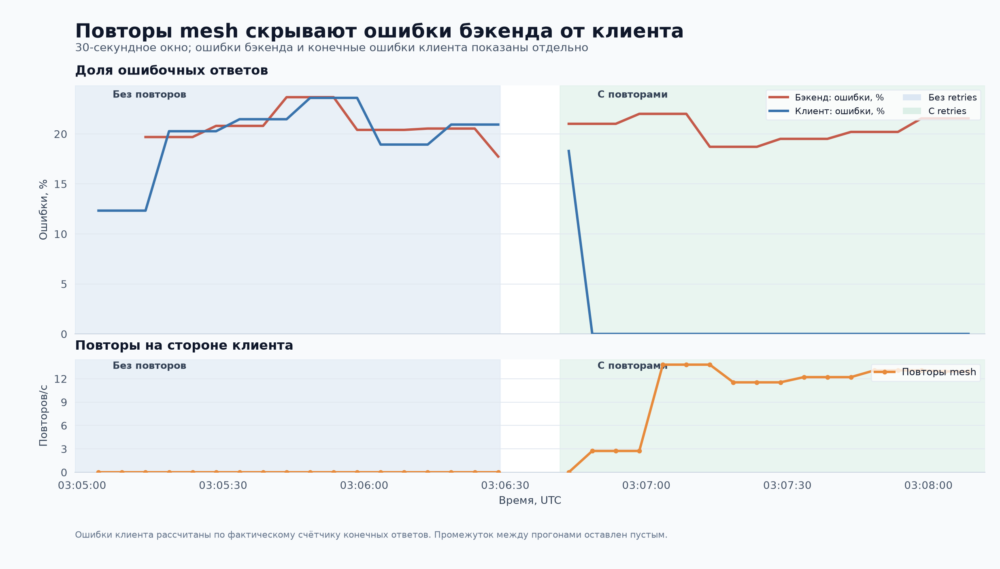
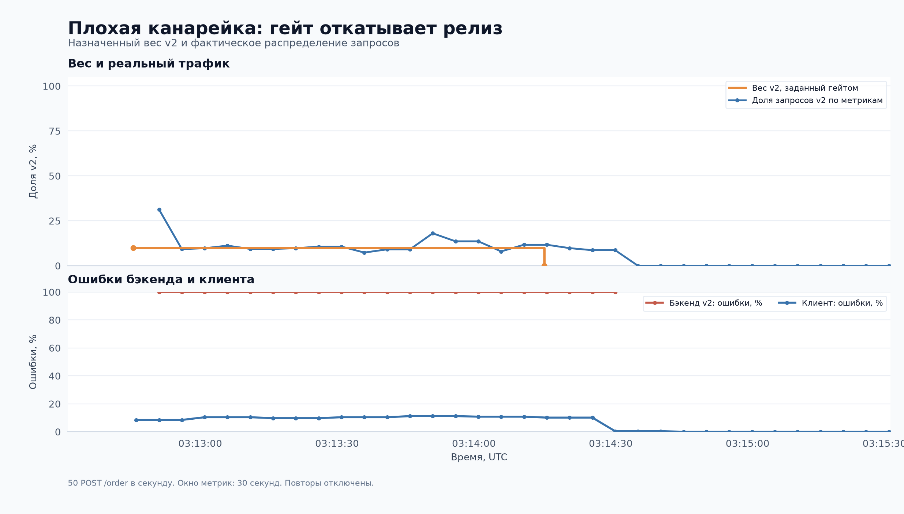
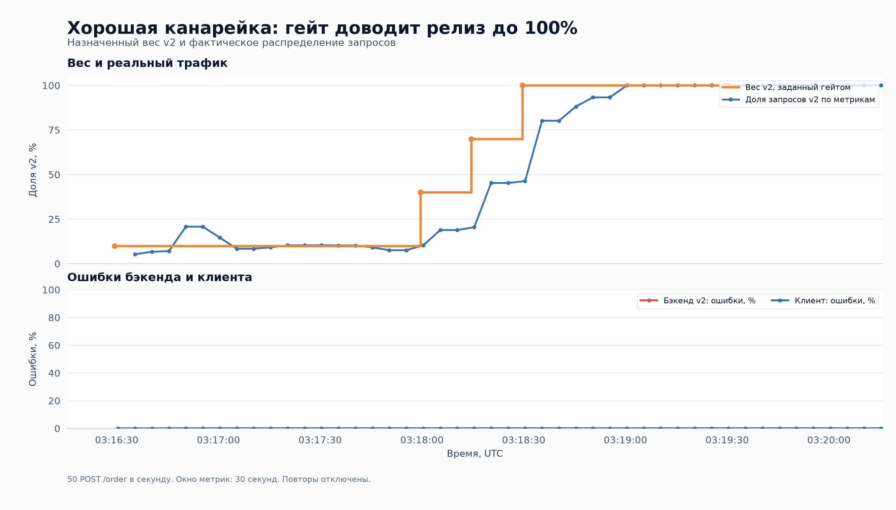
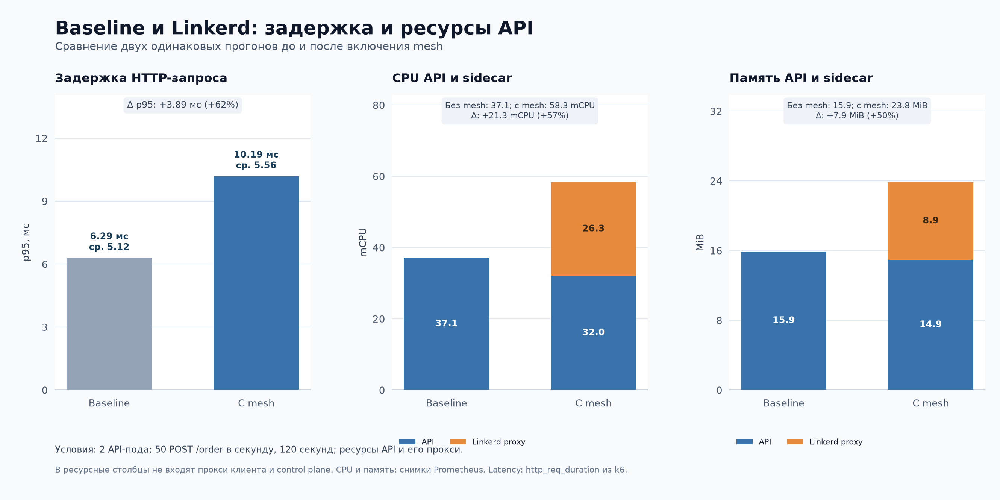
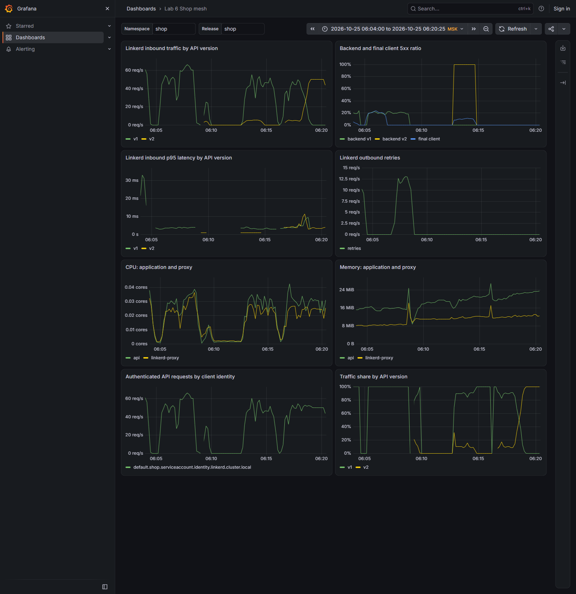

# Лабораторная работа № 6. Автоматический релиз через service mesh

Цель работы: проверить mTLS, повторы запросов и канареечный релиз на сервисе `shop`. Если новая версия сервиса API (`v2`) работает без ошибок, её доля трафика должна вырасти до 100%. При ошибках гейт должен вернуть трафик на предыдущую версию. Также измерено, как mesh влияет на задержку, CPU и память.

## Стенд и изменения

Выбран Linkerd: mTLS, повторы и разделение трафика можно настроить через чарт, без добавления этой логики в API.

За основу взят [чарт shop](charts/shop/Chart.yaml) из лабораторной № 3. В нём оставлены API и PostgreSQL с CloudNativePG. Нагрузку создаёт k6. Прокси Linkerd добавлен в поды API и k6. Прокси в поде k6 распределяет запросы между версиями API и повторяет запросы с ошибками. PostgreSQL, гейт и мониторинг работают без прокси.

Для мониторинга взяты настройки из [лабораторной № 2](../lab-2/monitoring/values.yaml) и [дополнительные настройки](platform/monitoring-values.yaml) для этого стенда. Grafana открывается без входа, с правами Viewer. Алерты доступны в локальном Alertmanager.

```console
PS C:\Users\jexu\Documents\projects\labs\apps-orchestration-and-containerization-labs> kubectl --context kind-lab6 get nodes
NAME                 STATUS   ROLES           AGE   VERSION
lab6-control-plane   Ready    control-plane   20m   v1.35.0

PS C:\Users\jexu\Documents\projects\labs\apps-orchestration-and-containerization-labs> helm list --kube-context kind-lab6 -A
NAME                  NAMESPACE   REVISION  UPDATED                               STATUS    CHART                           APP VERSION
cnpg                  cnpg-system 1         2026-10-25 05:54:29.7186313 +0300 MSK  deployed  cloudnative-pg-0.29.1            1.30.1
linkerd-control-plane linkerd     1         2026-10-25 05:57:13.1207163 +0300 MSK  deployed  linkerd-control-plane-2026.10.1  edge-26.10.1
linkerd-crds          linkerd     1         2026-10-25 05:57:07.7280875 +0300 MSK  deployed  linkerd-crds-2026.10.1
monitoring            monitoring  1         2026-10-25 05:54:31.3980636 +0300 MSK  deployed  kube-prometheus-stack-91.8.2     v0.94.1
shop                  shop        10        2026-10-25 06:20:10.3216046 +0300 MSK  deployed  shop-0.1.0                      1.0.0
```

[API](../lab-3/services/cmd/api/main.go) и [Dockerfile](../lab-3/services/Dockerfile) взяты из лабораторной № 3. Добавлен `GET /version`, который возвращает `{"version":"v1"}` или `{"version":"v2"}`. Версия задаётся при сборке через `APP_VERSION`. Образы собраны с тегами `registry.lab.local/shop/api:v1` и `registry.lab.local/shop/api:v2`.

При `FAIL=true` запросы к заказам завершаются HTTP 500. При `FLAKY=true` HTTP 500 случайно возникает примерно в 20% таких запросов. Ошибка возникает до записи заказа в БД. `/health`, `/ready` и `/metrics` продолжают работать. Поэтому под остаётся готовым к запросам даже при включённых искусственных ошибках.

[Гейт](gate/gate.py) собран по отдельному [Dockerfile](gate/Dockerfile). Он использует стандартную библиотеку Python. Его ServiceAccount может только читать и менять `HTTPRoute/shop-api` в namespace `shop`.

## Baseline без mesh

Сначала у v1 было две реплики, у v2 ноль. При `mesh.enabled=false` и `mesh.canaryWeight=0` поды работали без прокси и HTTPRoute. PostgreSQL работал в одном экземпляре с PVC 1 GiB.

[Сценарий k6](charts/shop/files/order.js) отправлял 50 запросов `POST /order` в секунду в течение 120 секунд. Каждый запрос создавал заказ в PostgreSQL. Проверка считала успешным только HTTP 201.

```console
PS C:\Users\jexu\Documents\projects\labs\apps-orchestration-and-containerization-labs> kubectl --context kind-lab6 -n shop `
> exec deployment/shop-load -c k6 -- `
> k6 run --summary-export=/tmp/baseline.json -e RATE=50 -e DURATION=120s /script/order.js
...
    checks_succeeded...: 100.00% 6001 out of 6001
    checks_failed......: 0.00%   0 out of 6001
...
    http_req_duration..............: avg=5.12ms med=3.7ms  p(95)=6.29ms p(99)=48.68ms max=119.69ms
...
    http_req_failed................: 0.00%  0 out of 6001
    http_reqs......................: 6001   50.008551/s
...
```

В конце теста два контейнера API вместе потребляли 37,1 mCPU и 15,9 MiB памяти. Это средние значения за минуту.

```console
PS C:\Users\jexu\Documents\projects\labs\apps-orchestration-and-containerization-labs> curl.exe -fsS -G http://127.0.0.1:39091/api/v1/query `
> --data-urlencode 'query=sum(rate(container_cpu_usage_seconds_total{namespace="shop",container="api"}[1m]))' `
> --data-urlencode 'time=2026-10-25T02:58:25Z'
{"status":"success","data":{"resultType":"vector","result":[{"metric":{},"value":[1792897105,"0.03705475696120682"]}]}}

PS C:\Users\jexu\Documents\projects\labs\apps-orchestration-and-containerization-labs> curl.exe -fsS -G http://127.0.0.1:39091/api/v1/query `
> --data-urlencode 'query=sum(avg_over_time(container_memory_working_set_bytes{namespace="shop",container="api"}[1m]))' `
> --data-urlencode 'time=2026-10-25T02:58:25Z'
{"status":"success","data":{"resultType":"vector","result":[{"metric":{},"value":[1792897105,"16658227.2"]}]}}
```

## mTLS и identity

В [шаблон Deployment](charts/shop/templates/deployments.yaml) добавлена аннотация `linkerd.io/inject: enabled`. Ресурсы прокси заданы в [values.yaml](charts/shop/values.yaml). После обновления в каждом поде появились контейнеры `api` и `linkerd-proxy`.

```console
PS C:\Users\jexu\Documents\projects\labs\apps-orchestration-and-containerization-labs> helm upgrade shop lab-6/charts/shop `
> --kube-context kind-lab6 -n shop `
> --set mesh.enabled=true --wait --timeout 3m
Release "shop" has been upgraded. Happy Helming!
NAME: shop
...
STATUS: deployed
REVISION: 2
DESCRIPTION: Upgrade complete
```

Из одного пода API отправлен запрос на IP-адрес второго.

```console
PS C:\Users\jexu\Documents\projects\labs\apps-orchestration-and-containerization-labs> kubectl --context kind-lab6 -n shop `
> exec shop-api-v1-5cddd7db5f-mz8v5 -c api -- wget -qO- http://10.244.0.27:8080/version
{"version":"v1"}

PS C:\Users\jexu\Documents\projects\labs\apps-orchestration-and-containerization-labs> kubectl --context kind-lab6 -n shop `
> exec shop-api-v1-5cddd7db5f-ntwb2 -c api -- wget -qO- http://127.0.0.1:4191/metrics
...
response_total{direction="inbound",target_addr="10.244.0.27:8080",...,tls="true",client_id="default.shop.serviceaccount.identity.linkerd.cluster.local",...,status_code="200",classification="success",...} 1
...
```

У принимающего прокси в метрике указаны `tls="true"` и identity клиента. Приложение отправляет обычный HTTP-запрос, а Linkerd шифрует его при передаче между подами.

Команда `linkerd identity` показала сертификаты обоих подов. Ниже приведён сертификат первого пода.

```console
PS C:\Users\jexu\Documents\projects\labs\apps-orchestration-and-containerization-labs> & C:/Users/jexu/AppData/Local/Temp/lab6-20261025/linkerd.exe `
> --context kind-lab6 identity -n shop -l app=shop-api
POD shop-api-v1-5cddd7db5f-mz8v5 (1 of 2)

Certificate:
    Data:
        Version: 3 (0x2)
        Serial Number: 4 (0x4)
    Signature Algorithm: ECDSA-SHA256
        Issuer: CN=identity.linkerd.cluster.local
        Validity
            Not Before: Oct 25 02:58:31 2026 UTC
            Not After : Oct 26 02:59:11 2026 UTC
        Subject: CN=default.shop.serviceaccount.identity.linkerd.cluster.local
...
            X509v3 Extended Key Usage:
                TLS Web Server Authentication, TLS Web Client Authentication
...
            X509v3 Subject Alternative Name:
                DNS:default.shop.serviceaccount.identity.linkerd.cluster.local
...
POD shop-api-v1-5cddd7db5f-ntwb2 (2 of 2)
...
```

Проверка `linkerd check` прошла: прокси готовы к работе, сертификаты проходят проверку подписи.

```console
PS C:\Users\jexu\Documents\projects\labs\apps-orchestration-and-containerization-labs> & C:/Users/jexu/AppData/Local/Temp/lab6-20261025/linkerd.exe `
> --context kind-lab6 check --proxy --namespace shop
...
√ certificate config is valid
...
√ issuer cert is issued by the trust anchor
...
√ data plane proxies certificate match CA
...
√ data plane proxies are ready
...
Status check results are √
```

В сертификатах обоих подов указан ServiceAccount `default` из namespace `shop`. При соединении Linkerd проверяет сертификат пода, а не его IP-адрес.

## Случайные ошибки и повторы

На v1 включён `FLAKY=true`. Первый прогон выполнен без повторов. Для этого при `mesh.retries.attempts=0` [шаблон Service](charts/shop/templates/services.yaml) не добавляет аннотации повторов. Одного `retry.linkerd.io/limit: "0"` не хватило: с аннотацией `http: 5xx` прокси всё ещё делал один повтор. После удаления этих аннотаций повторы отключились.

```console
PS C:\Users\jexu\Documents\projects\labs\apps-orchestration-and-containerization-labs> kubectl --context kind-lab6 -n shop `
> exec deployment/shop-load -c k6 -- `
> k6 run --quiet --summary-export=/tmp/flaky-disabled.json -e RATE=50 -e DURATION=90s /script/order.js
...
    checks_succeeded...: 79.51% 3579 out of 4501
    checks_failed......: 20.48% 922 out of 4501
...
    http_req_failed................: 20.48% 922 out of 4501
    http_reqs......................: 4501
...
```

Во втором прогоне Linkerd мог повторить запрос до пяти раз при HTTP 5xx. Таймаут запроса составил 500 мс. Код API и настройка случайных ошибок не менялись.

```console
PS C:\Users\jexu\Documents\projects\labs\apps-orchestration-and-containerization-labs> helm upgrade shop lab-6/charts/shop `
> --kube-context kind-lab6 -n shop --reuse-values `
> --set mesh.retries.attempts=5 --wait --timeout 2m
Release "shop" has been upgraded. Happy Helming!
...
STATUS: deployed
REVISION: 5
...

PS C:\Users\jexu\Documents\projects\labs\apps-orchestration-and-containerization-labs> kubectl --context kind-lab6 -n shop `
> exec deployment/shop-load -c k6 -- `
> k6 run --quiet --summary-export=/tmp/flaky-retries.json -e RATE=50 -e DURATION=90s /script/order.js
...
    checks_succeeded...: 100.00% 4501 out of 4501
    checks_failed......: 0.00%   0 out of 4501
...
    http_req_duration..............: avg=17.57ms ... p(95)=55.24ms p(99)=144.17ms max=570.69ms
...
    http_req_failed................: 0.00%  0 out of 4501
    http_reqs......................: 4501
...
```



На верхнем графике около 20% запросов к API завершаются ошибкой. После включения повторов ошибки клиента падают до нуля. Каждая точка учитывает данные за предыдущие 30 секунд, поэтому изменение видно не сразу.

Linkerd повторял запросы, на которые API ответил ошибкой 500. Если повтор проходил успешно, клиент получал 201. Поэтому на графике ошибки API есть, а у клиента их нет.

Счётчики прокси после эксперимента:

```console
PS C:\Users\jexu\Documents\projects\labs\apps-orchestration-and-containerization-labs> kubectl --context kind-lab6 -n shop `
> exec deployment/shop-load -c k6 -- wget -qO- http://127.0.0.1:4191/metrics | `
> Select-String '^outbound_http_route_retry_(requests|successes|limit_exceeded|overflow)_total\{' | ForEach-Object Line
outbound_http_route_retry_limit_exceeded_total{...,parent_name="shop-api",...} 181
outbound_http_route_retry_overflow_total{...,parent_name="shop-api",...} 0
outbound_http_route_retry_requests_total{...,parent_name="shop-api",...} 2045
outbound_http_route_retry_successes_total{...,parent_name="shop-api",...} 1653
```

За время нагрузки счётчики изменились так:

- `outbound_http_route_retry_requests_total`: 899 и 2045, прирост 1146.
- `outbound_http_route_retry_successes_total`: 718 и 1653, прирост 935.
- `outbound_http_route_retry_limit_exceeded_total`: 181 и 181, без новых превышений лимита.
- `outbound_http_route_retry_overflow_total`: 0 и 0.

Клиент отправил 4501 запрос. С учётом повторов API обработал 5647 попыток. Из них 1146 завершились HTTP 500, то есть 20,29%. Клиент получил только HTTP 201. Число попыток выросло на 25,46%.

Повторы скрыли ошибки API от клиента. Это подтверждает рост счётчиков Linkerd. Правила outlier detection и circuit breaking не настраивались.

В этом тесте повторы `POST /order` не создают дубли: искусственная ошибка возникает до записи в БД. Если ошибка случится после сохранения заказа, повтор может создать ещё один заказ. Для такого случая нужен ключ идемпотентности.

## Разделение трафика 90/10

Случайные ошибки и повторы отключены. У v1 оставлены две реплики, у v2 запущена одна. [HTTPRoute](charts/shop/templates/mesh.yaml) задаёт распределение запросов к Service `shop-api:8080`. Для `shop-api-v1` установлен вес 90, для `shop-api-v2` вес 10.

```console
PS C:\Users\jexu\Documents\projects\labs\apps-orchestration-and-containerization-labs> helm upgrade shop lab-6/charts/shop `
> --kube-context kind-lab6 -n shop --reuse-values `
> --set api.versions.v1.flaky=false --set api.versions.v2.replicas=1 `
> --set mesh.canaryWeight=10 --set mesh.retries.attempts=0 --wait --timeout 2m
Release "shop" has been upgraded. Happy Helming!
...
STATUS: deployed
REVISION: 6
...

PS C:\Users\jexu\Documents\projects\labs\apps-orchestration-and-containerization-labs> kubectl --context kind-lab6 -n shop get httproute shop-api `
> -o jsonpath='{.spec.rules[0].backendRefs}{"\n"}'
[{"group":"","kind":"Service","name":"shop-api-v1","port":8080,"weight":90},{"group":"","kind":"Service","name":"shop-api-v2","port":8080,"weight":10}]

PS C:\Users\jexu\Documents\projects\labs\apps-orchestration-and-containerization-labs> kubectl --context kind-lab6 -n shop `
> exec deployment/shop-load -c k6 -- `
> k6 run --quiet --summary-export=/tmp/split.json -e MODE=version -e RATE=50 -e DURATION=20s /script/order.js
...
    checks_succeeded...: 100.00% 1001 out of 1001
    checks_failed......: 0.00%   0 out of 1001
...
    responses_v1...................: 883    44.144898/s
    responses_v2...................: 118    5.899318/s
...
    http_req_failed................: 0.00%  0 out of 1001
    http_reqs......................: 1001   50.044216/s
...
```

Сценарий определял версию по полю `version` в ответах `GET /version`. На v1 пришлось 88,21% ответов, на v2 11,79%. Версия для каждого запроса выбирается случайно с учётом весов, поэтому ровно 900 и 100 ответов ждать не стоит. Полученные доли близки к заданным 90/10.

## Логика гейта

[CronJob гейта](charts/shop/templates/gate.yaml) приостановлен и по расписанию не запускается. Для каждого сценария создан отдельный Job. После запуска гейт сам меняет веса.

Сначала гейт ставит v2 вес 10. Первую проверку он делает через 90 секунд, когда в Prometheus уже есть данные за минуту. Следующие проверки идут каждые 15 секунд. Гейт смотрит на три показателя:

- число запросов v2: `increase(http_requests_total[1m])`;
- долю ошибок v2: `increase(http_errors_total[1m]) / increase(http_requests_total[1m])`;
- p95 v2: `histogram_quantile(0.95, sum by(le)(increase(http_request_duration_seconds_bucket[1m])))`.

Гейт учитывает только запросы `POST` на `/order` у версии `v2` в namespace `shop`. Проверки здоровья и запросы метрик в расчёт не входят.

Для повышения веса нужно минимум 30 запросов за минуту, не больше 5% ошибок и p95 не выше 200 мс. Если условия выполнены, гейт поднимает вес до 40, затем до 70 и 100. На весе 100 он ждёт ещё минуту и проверяет показатели снова. Если доля ошибок или задержка превышает порог, гейт сразу снижает вес v2 до 0.

Если данных нет или вместо числа пришёл `NaN`, гейт не повышает вес. После трёх таких проверок он откатывает трафик. При ошибке запроса к Prometheus или Kubernetes гейт тоже пытается выполнить откат. Если изменить маршрут не удалось, Job завершается с ошибкой.

## Плохая v2: автоматический откат

Через Helm включён `api.versions.v2.fail=true`, вес v2 установлен в 10. Тест отправлял 50 запросов `POST /order` в секунду в течение 180 секунд. Повторы были отключены, чтобы ошибки были видны клиенту.

```console
PS C:\Users\jexu\Documents\projects\labs\apps-orchestration-and-containerization-labs> helm upgrade shop lab-6/charts/shop `
> --kube-context kind-lab6 -n shop --reuse-values `
> --set api.versions.v2.fail=true --set mesh.canaryWeight=10 --wait --timeout 2m
Release "shop" has been upgraded. Happy Helming!
...
STATUS: deployed
REVISION: 7
...

PS C:\Users\jexu\Documents\projects\labs\apps-orchestration-and-containerization-labs> kubectl --context kind-lab6 -n shop `
> exec deployment/shop-load -c k6 -- `
> k6 run --quiet --summary-export=/tmp/bad.json -e RATE=50 -e DURATION=180s /script/order.js
...
    checks_succeeded...: 94.08% 8469 out of 9001
    checks_failed......: 5.91%  532 out of 9001
...
    http_req_failed................: 5.91%  532 out of 9001
    http_reqs......................: 9001   50.006447/s
...
```

Во время нагрузки запущен гейт:

```console
PS C:\Users\jexu\Documents\projects\labs\apps-orchestration-and-containerization-labs> kubectl --context kind-lab6 -n shop create job --from=cronjob/shop-release-gate gate-bad
job.batch/gate-bad created

PS C:\Users\jexu\Documents\projects\labs\apps-orchestration-and-containerization-labs> kubectl --context kind-lab6 -n shop wait --for=condition=complete job/gate-bad --timeout=160s
job.batch/gate-bad condition met

PS C:\Users\jexu\Documents\projects\labs\apps-orchestration-and-containerization-labs> kubectl --context kind-lab6 -n shop logs job/gate-bad
{"timestamp": "2026-10-25T03:12:45.321206+00:00", "weight": 10, "candidate_error": null, "candidate_p95_seconds": null, "candidate_requests": null, "action": "start"}
{"timestamp": "2026-10-25T03:14:15.417783+00:00", "weight": 0, "candidate_error": 1.0, "candidate_p95_seconds": 0.004750000000000001, "candidate_requests": 324.0288025602276, "action": "rollback"}

PS C:\Users\jexu\Documents\projects\labs\apps-orchestration-and-containerization-labs> kubectl --context kind-lab6 -n shop get httproute shop-api `
> -o jsonpath='{.spec.rules[0].backendRefs}{"\n"}'
[{"group":"","kind":"Service","name":"shop-api-v1","port":8080,"weight":100},{"group":"","kind":"Service","name":"shop-api-v2","port":8080,"weight":0}]
```

Через 90 секунд гейт обнаружил 100% ошибок у v2 и поставил ей вес 0. Версия отвечала быстро, но из-за ошибок проверку не прошла. После отката все новые запросы пошли на v1. За весь прогон доля ошибок составила 5,91%. Все они возникли до отката.



График показывает вес, заданный гейтом, и долю запросов, которую получила v2. Эта доля рассчитана по `response_total` Linkerd. Ниже показаны ошибки v2 и ошибки, дошедшие до клиента. После отката v2 перестала получать запросы, поэтому линия её ошибок обрывается. Каждая точка учитывает предыдущие 30 секунд, поэтому линии меняются с задержкой.

## Хорошая v2: автоматическое продвижение

Для следующего запуска `FAIL` отключён, вес возвращён в 10. Helm 4 сначала не смог обновить `HTTPRoute`: гейт уже изменил поле `.spec.rules` от имени `Python-urllib`. Первый Job к этому моменту завершился. Флаг `--force-conflicts` позволил Helm снова изменить маршрут и задать начальные веса.

```console
PS C:\Users\jexu\Documents\projects\labs\apps-orchestration-and-containerization-labs> helm upgrade shop lab-6/charts/shop `
> --kube-context kind-lab6 -n shop --reuse-values `
> --set api.versions.v2.fail=false --set mesh.canaryWeight=10 --force-conflicts --wait --timeout 2m
Release "shop" has been upgraded. Happy Helming!
...
STATUS: deployed
REVISION: 9
...
```

Нагрузка шла 240 секунд. После старта нагрузки создан отдельный Job `gate-good`.

```console
PS C:\Users\jexu\Documents\projects\labs\apps-orchestration-and-containerization-labs> kubectl --context kind-lab6 -n shop `
> exec deployment/shop-load -c k6 -- `
> k6 run --quiet --summary-export=/tmp/good.json -e RATE=50 -e DURATION=240s /script/order.js
...
    checks_succeeded...: 100.00% 12000 out of 12000
    checks_failed......: 0.00%   0 out of 12000
...
    http_req_failed................: 0.00%  0 out of 12000
    http_reqs......................: 12000  50.002063/s
...

PS C:\Users\jexu\Documents\projects\labs\apps-orchestration-and-containerization-labs> kubectl --context kind-lab6 -n shop create job --from=cronjob/shop-release-gate gate-good
job.batch/gate-good created

PS C:\Users\jexu\Documents\projects\labs\apps-orchestration-and-containerization-labs> kubectl --context kind-lab6 -n shop wait --for=condition=complete job/gate-good --timeout=220s
job.batch/gate-good condition met

PS C:\Users\jexu\Documents\projects\labs\apps-orchestration-and-containerization-labs> kubectl --context kind-lab6 -n shop logs job/gate-good
{"timestamp": "2026-10-25T03:16:29.403250+00:00", "weight": 10, "candidate_error": null, "candidate_p95_seconds": null, "candidate_requests": null, "action": "start"}
{"timestamp": "2026-10-25T03:17:59.518023+00:00", "weight": 40, "candidate_error": 0.0, "candidate_p95_seconds": 0.0049964622641509426, "candidate_requests": 297.3531568771252, "action": "advance"}
{"timestamp": "2026-10-25T03:18:14.543007+00:00", "weight": 70, "candidate_error": 0.0, "candidate_p95_seconds": 0.0055714285714285735, "candidate_requests": 517.3448298851085, "action": "advance"}
{"timestamp": "2026-10-25T03:18:29.564935+00:00", "weight": 100, "candidate_error": 0.0, "candidate_p95_seconds": 0.009116071428571435, "candidate_requests": 1117.4078271884794, "action": "advance"}
{"timestamp": "2026-10-25T03:19:29.567605+00:00", "weight": 100, "candidate_error": 0.0, "candidate_p95_seconds": 0.004895785616124598, "candidate_requests": 3000.2666903724776, "action": "success"}

PS C:\Users\jexu\Documents\projects\labs\apps-orchestration-and-containerization-labs> kubectl --context kind-lab6 -n shop get httproute shop-api `
> -o jsonpath='{.spec.rules[0].backendRefs}{"\n"}'
[{"group":"","kind":"Service","name":"shop-api-v1","port":8080,"weight":0},{"group":"","kind":"Service","name":"shop-api-v2","port":8080,"weight":100}]
```

Гейт сам поднял вес до 40, 70 и 100. Ещё через минуту на полном трафике ошибок не было, а p95 API составил около 4,90 мс. Job завершился с действием `success`.



В [финальном values.yaml](charts/shop/values.yaml) сохранены `mesh.enabled=true`, `mesh.canaryWeight=100`, две реплики v1 и одна v2. `FAIL`, `FLAKY` и повторы отключены. После завершения Job настройки применены через Helm с `--reset-values --force-conflicts`. У `HTTPRoute` состояния `Accepted=True` и `ResolvedRefs=True`. Поды API работают со статусом `2/2 Running`, PostgreSQL со статусом `1/1 Running`.

## Стоимость mesh

После включения mesh повторён первый тест: две исправные реплики v1, 50 `POST /order` в секунду, 120 секунд. Замер сделан до опытов с ошибками и v2. Повторы были отключены.

```console
PS C:\Users\jexu\Documents\projects\labs\apps-orchestration-and-containerization-labs> kubectl --context kind-lab6 -n shop `
> exec deployment/shop-load -c k6 -- `
> k6 run --quiet --summary-export=/tmp/mesh.json -e RATE=50 -e DURATION=120s /script/order.js
...
    checks_succeeded...: 100.00% 6001 out of 6001
    checks_failed......: 0.00%   0 out of 6001
...
    http_req_duration..............: avg=5.56ms med=4.7ms  p(95)=10.18ms p(99)=20.17ms max=52.39ms
...
    http_req_failed................: 0.00%  0 out of 6001
    http_reqs......................: 6001   50.008291/s
...
```

CPU и память измерены за минуту в конце теста. Учтены только поды API с их прокси. Прокси k6 в расчёт не входит.

```console
PS C:\Users\jexu\Documents\projects\labs\apps-orchestration-and-containerization-labs> curl.exe -fsS -G http://127.0.0.1:39091/api/v1/query `
> --data-urlencode 'query=sum by(container)(rate(container_cpu_usage_seconds_total{namespace="shop",pod=~"shop-api-v1-.*",container=~"api|linkerd-proxy"}[1m]))' `
> --data-urlencode 'time=2026-10-25T03:01:30Z'
{"status":"success","data":{"resultType":"vector","result":[{"metric":{"container":"api"},"value":[1792897290,"0.03201455873094401"]},{"metric":{"container":"linkerd-proxy"},"value":[1792897290,"0.026296021123230977"]}]}}

PS C:\Users\jexu\Documents\projects\labs\apps-orchestration-and-containerization-labs> curl.exe -fsS -G http://127.0.0.1:39091/api/v1/query `
> --data-urlencode 'query=sum by(container)(avg_over_time(container_memory_working_set_bytes{namespace="shop",pod=~"shop-api-v1-.*",container=~"api|linkerd-proxy"}[1m]))' `
> --data-urlencode 'time=2026-10-25T03:01:30Z'
{"status":"success","data":{"resultType":"vector","result":[{"metric":{"container":"api"},"value":[1792897290,"15666517.333333332"]},{"metric":{"container":"linkerd-proxy"},"value":[1792897290,"9324202.666666668"]}]}}
```



Средняя задержка выросла с 5,122 до 5,561 мс, на 8,6%. p95 вырос с 6,293 до 10,187 мс, на 3,894 мс или 61,9%. Для расчёта взяты полные значения k6. В выводе k6 дробная часть сокращена, а на графике p95 округлён до 10,19 мс.

API вместе с прокси стал потреблять 58,3 mCPU вместо 37,1 mCPU, рост на 57,4%. Из них 32,0 mCPU использовал API, 26,3 mCPU прокси. Потребление памяти выросло с 15,9 до 23,8 MiB, на 50,0%. Прокси заняли 8,9 MiB.

Сам API во втором тесте потреблял немного меньше ресурсов. По двум коротким тестам на одном узле нельзя сказать, что он стал работать эффективнее. В расчёт вошли API и его прокси. Control plane Linkerd и прокси клиента тоже потребляют ресурсы, но здесь они не учтены. Время ответа измерено со стороны k6, поэтому включает прохождение через оба прокси.

Для такой небольшой системы mesh только ради повторов и распределения запросов не нужен. CPU и памяти требуется больше, а за control plane и сертификатами нужно следить отдельно. Mesh может быть полезен, если нескольким сервисам нужны mTLS, общая identity и одинаковые правила релиза. В этой работе он выполнил свои задачи, но увеличил задержку и расход ресурсов.

## Мониторинг и алерты

В [monitoring.yaml](charts/shop/templates/monitoring.yaml) добавлены `ServiceMonitor` для API, `PodMonitor` для прокси и `PrometheusRule`. Prometheus собирает метрики каждые 15 секунд. Метка `version` берётся из пода.

```console
PS C:\Users\jexu\Documents\projects\labs\apps-orchestration-and-containerization-labs> kubectl --context kind-lab6 -n shop get servicemonitor,podmonitor,prometheusrule
NAME                                            AGE
servicemonitor.monitoring.coreos.com/shop-app   18m

NAME                                            AGE
podmonitor.monitoring.coreos.com/shop-proxies   15m

NAME                                             AGE
prometheusrule.monitoring.coreos.com/shop-mesh   18m
```

В чарт добавлен [дашборд Grafana](charts/shop/dashboards/mesh.json). На нём видно, как трафик делится между v1 и v2, сколько возникает ошибок и как меняется время ответа. Отдельные графики показывают повторы запросов и потребление CPU и памяти.



В Grafana указано московское время, на остальных графиках и в логах гейта UTC.

Добавлены три алерта. Каждый срабатывает, если условие сохраняется 30 секунд:

- `ShopApiBusiness5xxRatio`: за минуту больше 5% запросов к заказам завершились ошибкой. Алерт показывает проблему в API, даже если повторы скрыли ошибки от клиента.
- `ShopApiBusinessP95Latency`: p95 запросов к заказам за минуту превысил 200 мс. Алерт показывает, что API стал отвечать медленнее. Такой же порог использует гейт.
- `ShopApiUpstreamRetries`: прокси k6 за минуту в среднем выполняет больше 0,1 повтора в секунду. Алерт показывает лишние запросы к API, даже если клиент получает успешные ответы.

При `FLAKY=true` сработал `ShopApiBusiness5xxRatio` и перешёл в `firing`. Доля ошибок v1 составила 0,214995. Prometheus загрузил все три правила и проверяет их без ошибок. После восстановления API у всех алертов состояние `inactive`.

```console
PS C:\Users\jexu\Documents\projects\labs\apps-orchestration-and-containerization-labs> (curl.exe -fsS 'http://127.0.0.1:39091/api/v1/rules?type=alert' | ConvertFrom-Json).data.groups.rules | `
> Where-Object name -Like 'ShopApi*' | Select-Object name,health,state | Format-List
name   : ShopApiBusiness5xxRatio
health : ok
state  : inactive

name   : ShopApiBusinessP95Latency
health : ok
state  : inactive

name   : ShopApiUpstreamRetries
health : ok
state  : inactive
```
