# Лабораторная работа № 7. Проверка готовности релиза через n8n

## Кейс

Для работы придумана компания ShopFlow. Она разрабатывает сервис заказов `shop-api`. В команде 12 разработчиков, два QA-инженера и два DevOps-инженера. Перед выпуском QA собирает результаты тестов, а DevOps проверяет образ, состояние тестового окружения staging и возможность отката. Данные находятся в разных системах. При ручной проверке можно пропустить неудачную миграцию или взять результаты другого релиза.

Автоматизация помогает QA и DevOps собрать проверки одного релиза в один отчёт. Workflow принимает идентификатор релиза, собирает данные, получает пояснение AI и сохраняет решение в Markdown и JSON. Решение принимает узел Code по заданным условиям. Выкладка сервиса в работу не входит.

[Тестовые данные](release-readiness/fixtures) заданы в JSON: 412 unit-тестов, 63 интеграционных теста и 40% свободных ресурсов. У плохого релиза миграция заблокировала бы таблицу заказов на 14 минут. Это вымышленные данные ShopFlow. n8n, модель и вызовы инструментов проверены реальными запросами.

## Стенд и запуск

В [Compose](release-readiness/compose.yaml) работают n8n 2.44.6, Ollama 0.40.11, сервис отчётов `agent`, два MCP-сервера, Prometheus 3.5.0, Grafana 12.2.1 и Alertmanager 0.28.1. MCP используется как протокол вызова инструментов. Python-сервис [agent](release-readiness/service/app.py) сохраняет отчёты и отдаёт метрики. Модель и инструменты вызывает сам n8n.

В блоках команд `PS ...\lab-7\release-readiness>` означает каталог `C:\Users\jexu\Documents\projects\labs\apps-orchestration-and-containerization-labs\lab-7\release-readiness`.

Контейнеры запущены через Compose. Для Python-сервисов собран [образ](release-readiness/service/Dockerfile).

```console
PS ...\lab-7\release-readiness> docker compose up -d --build
...
 Image lab7-release-agent:1.0.0 Built
...

PS ...\lab-7\release-readiness> docker compose ps --format '{{.Service}}: {{.State}}'
agent: running
alertmanager: running
grafana: running
n8n: running
ollama: running
ops-mcp: running
prometheus: running
release-mcp: running

PS ...\lab-7\release-readiness> curl.exe -fsS http://127.0.0.1:45678/healthz
{"status":"ok"}
```

Загрузка модели на GPU зависла. После перехода на CPU запросы начали завершаться. Все приведённые ниже проверки выполнены на CPU.

```console
PS ...\lab-7\release-readiness> docker compose exec -T ollama ollama ps
NAME                 ID              SIZE      PROCESSOR    CONTEXT    RUNNER      UNTIL
qwen3:4b-instruct    0edcdef34593    3.2 GB    100% CPU     4096       llamacpp    29 minutes from now
```

n8n доступен на [localhost:45678](http://localhost:45678), Grafana на [localhost:43000](http://localhost:43000/d/release-readiness/release-readiness). Порты опубликованы только на loopback.

## Workflow в n8n

В редактор n8n импортирована схема. В интерфейсе создано подключение [Ollama account](release-readiness/ollama-credential.json) с адресом `http://ollama:11434`, выбрана модель `qwen3:4b-instruct`. Затем выполнен тестовый запуск и нажата кнопка Publish. [workflow.json](release-readiness/workflow.json) выгружен через Export JSON. В нём 12 узлов, закреплённых тестовых данных нет.

На снимке выполнения №18 видны AI Agent, Ollama Chat Model и два MCP Client Tool. Оба MCP-узла выполнили по два вызова.

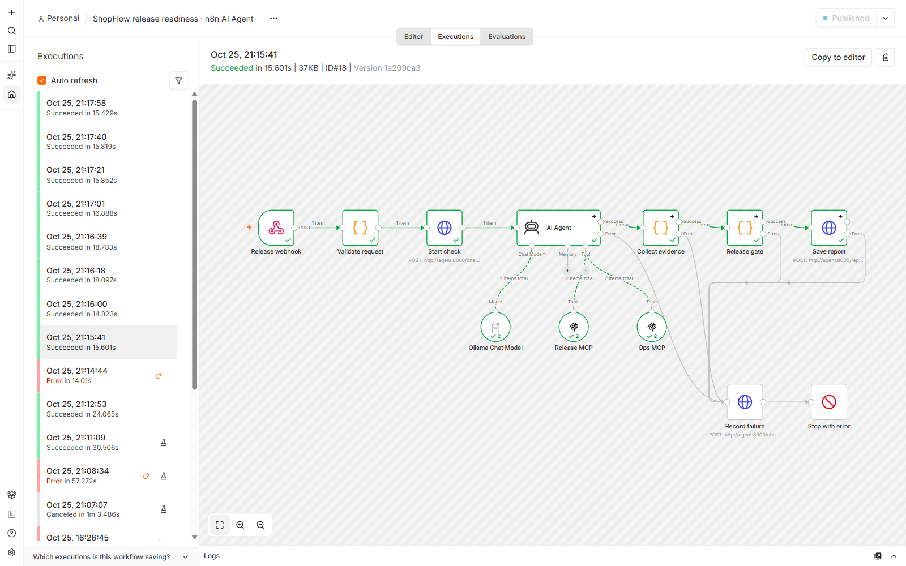

Основной путь состоит из следующих шагов:

1. **Release webhook** принимает POST с `release_id` и `environment`.
2. **Validate request** проверяет идентификатор и разрешает только `staging`.
3. **Start check** начинает измерение времени и читает инструкцию агента.
4. **AI Agent** вызывает модель Ollama и четыре MCP-инструмента.
5. **Collect evidence** извлекает исходные ответы инструментов из `intermediateSteps`, списка выполненных агентом действий.
6. **Release gate** проверяет данные обычным JavaScript-кодом.
7. **Save report** сохраняет Markdown и JSON с решением и номером выполнения.

При ошибке узлы **Record failure** и **Stop with error** записывают причину и завершают workflow с ошибкой.

### Модель и skill

В узле Ollama установлены температура `0` и `Enable Thinking=false`.

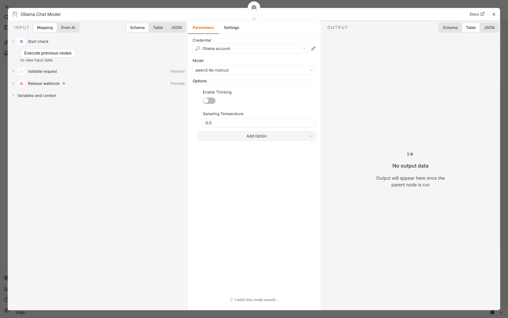

[SKILL.md](release-readiness/SKILL.md) передаётся в System Message узла AI Agent. Инструкция требует получить релиз, проверки, окружение и порядок отката, затем дать короткую сводку. Агенту запрещено придумывать результаты и менять данные. Включён `Return Intermediate Steps`, поэтому Code проверяет ответы инструментов отдельно от текста модели.

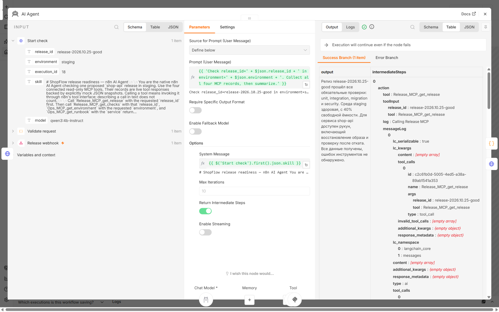

### Два MCP-сервера и toolkit

[release-mcp](release-readiness/service/release_server.py) и [ops-mcp](release-readiness/service/ops_server.py) работают в отдельных контейнерах. Узлы n8n подключены к ним через HTTP Streamable. В toolkit, набор инструментов агента, входят четыре функции:

- `get_release(release_id)` возвращает версию, digest, то есть хеш образа, признак подписи и готовность отката.
- `get_checks(release_id)` возвращает обязательные проверки и их результаты.
- `get_environment(environment)` возвращает состояние окружения и долю свободных ресурсов.
- `get_runbook(service)` возвращает шаги отката указанного сервиса.

n8n добавляет к именам префиксы `Release_MCP_` и `Ops_MCP_`. На снимках выполнения №15 показаны адреса обоих серверов, аргументы и полученные ответы.

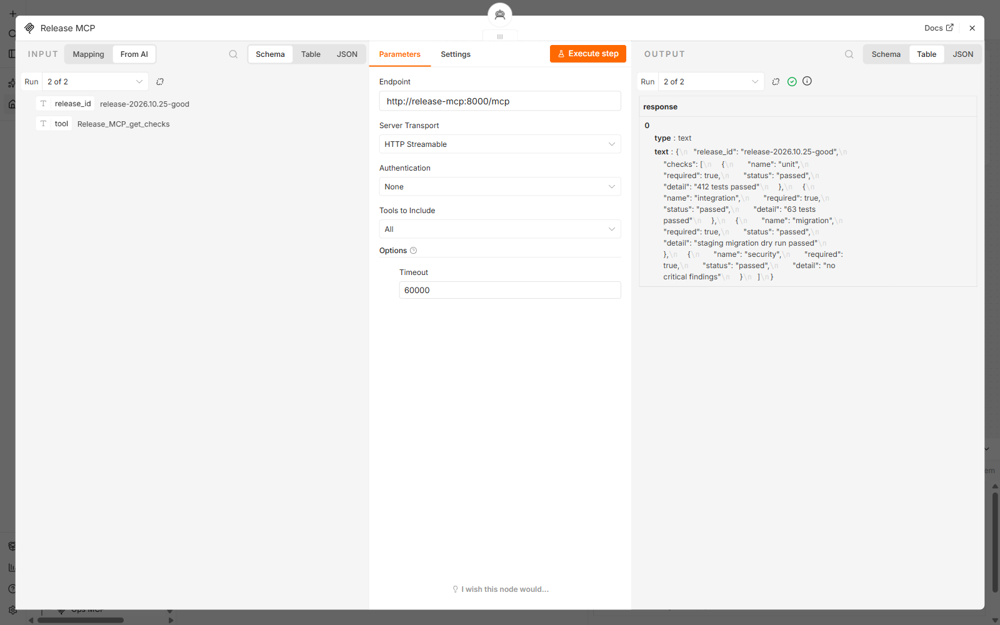

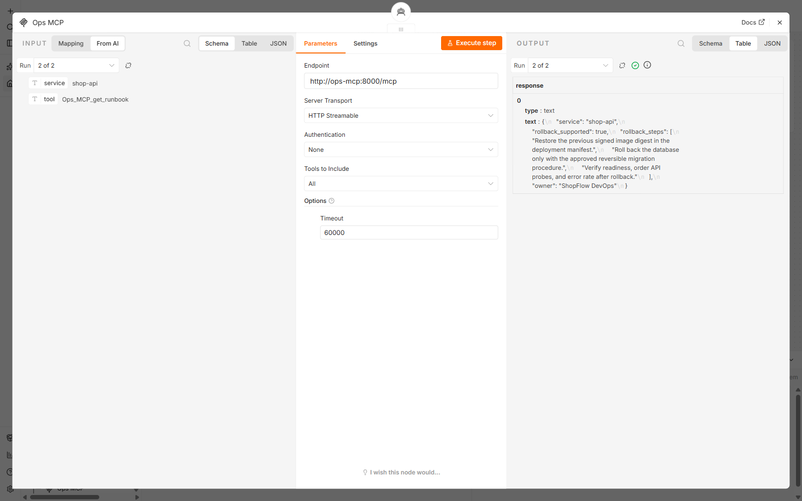

В сохранённом отчёте видны все четыре вызова:

```console
PS ...\lab-7\release-readiness> (Get-Content results/release-2026.10.25-good.json -Raw | ConvertFrom-Json).tool_calls | `
> ForEach-Object { '{0}: {1} {2}' -f $_.server,$_.tool,($_.arguments | ConvertTo-Json -Compress) }
release-mcp: get_release {"release_id":"release-2026.10.25-good"}
release-mcp: get_checks {"release_id":"release-2026.10.25-good"}
ops-mcp: get_environment {"environment":"staging"}
ops-mcp: get_runbook {"service":"shop-api"}
```

Гейт разрешает релиз, если все обязательные проверки пройдены, digest имеет формат SHA-256, образ подписан, а откат подготовлен. Staging и shop-api должны быть здоровы, свободных ресурсов должно быть не меньше 30%. В runbook должны быть шаги отката. Идентификаторы в ответах должны совпадать с запросом.

Первый отчёт отклонялся с HTTP 422: n8n добавлял служебное поле `tool` к аргументам. В Collect evidence поле проверяется и удаляется перед сохранением аргументов. Следующие десять проверок good и bad завершились с отчётом.

## Результаты проверок

После нажатия Execute в n8n отправлен [good.json](release-readiness/requests/good.json) на тестовый webhook.

```console
PS ...\lab-7\release-readiness> curl.exe -sS --max-time 300 -w '\nHTTP %{http_code}\n' `
> -H 'Content-Type: application/json' --data-binary '@requests/good.json' `
> http://127.0.0.1:45678/webhook-test/release-readiness
{"release_id":"release-2026.10.25-good","decision":"approved","reasons":[],"report":"/results/release-2026.10.25-good.md","tool_calls":4,"execution_id":"15","duration_seconds":30.438}
HTTP 200
```

После публикации отправлен [bad.json](release-readiness/requests/bad.json). У него обязательная проверка миграции имеет статус `failed`.

```console
PS ...\lab-7\release-readiness> curl.exe -sS --max-time 300 -w '\nHTTP %{http_code}\n' `
> -H 'Content-Type: application/json' --data-binary '@requests/bad.json' `
> http://127.0.0.1:45678/webhook/release-readiness
{"release_id":"release-2026.10.25-bad","decision":"blocked","reasons":["Required check failed: migration"],"report":"/results/release-2026.10.25-bad.md","tool_calls":4,"execution_id":"16","duration_seconds":24.031}
HTTP 200
```

Гейт разрешил первый релиз и заблокировал второй. HTTP 200 означает, что проверка закончена и отчёт сохранён. Ниже те же решения при повторных запусках №18 и №19.

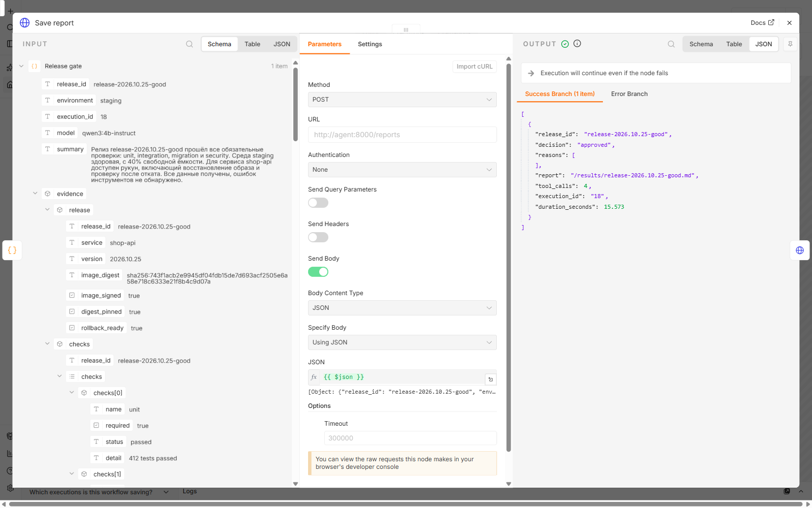

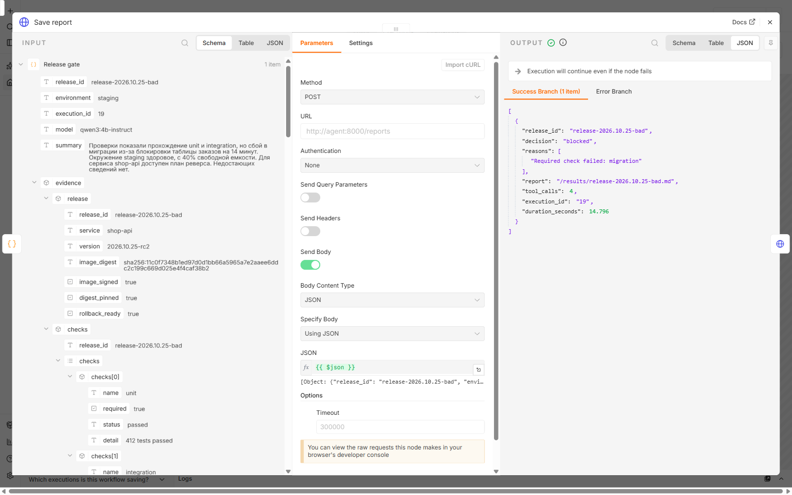

Каждый вариант дополнительно отправлен четыре раза с паузой три секунды. [Серия из восьми запросов](release-readiness/results/batch.json) дала четыре `approved` и четыре `blocked`.

```console
PS ...\lab-7\release-readiness> Get-Content results/batch.json -Raw | ConvertFrom-Json | `
> Measure-Object http_seconds -Minimum -Maximum -Average | Format-List Count,Average,Minimum,Maximum
Count   : 8
Average : 16,456375
Minimum : 14,855
Maximum : 18,82
```

Клиент получал решение в среднем за 16,456 секунды. Последние [отчёт good](release-readiness/results/release-2026.10.25-good.md) и [отчёт bad](release-readiness/results/release-2026.10.25-bad.md) относятся к выполнениям №24 и №25. Рядом сохранены [JSON good](release-readiness/results/release-2026.10.25-good.json) и [JSON bad](release-readiness/results/release-2026.10.25-bad.json) с исходными данными MCP. При повторной проверке файл релиза обновляется. [История n8n](release-readiness/results/executions.json) содержит статусы и время выполнений.

Для проверки отсутствующих данных отправлен [неизвестный релиз](release-readiness/requests/missing.json).

```console
PS ...\lab-7\release-readiness> curl.exe -sS --max-time 300 -w '\nHTTP %{http_code}\n' `
> -H 'Content-Type: application/json' --data-binary '@requests/missing.json' `
> http://127.0.0.1:45678/webhook/release-readiness
{"message":"Error in workflow"}
HTTP 500

PS ...\lab-7\release-readiness> Test-Path results/release-unknown.json
False
```

Выполнение №17 остановилось с причиной `Missing evidence from get_release`. [Ошибка сохранена](release-readiness/results/failures/17.json). Отчёт с разрешением не создан.

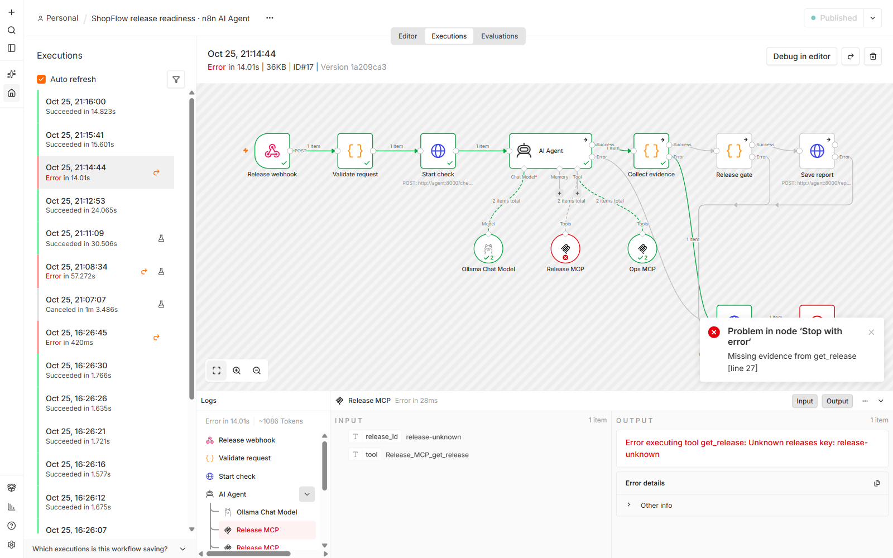

## Мониторинг

[Prometheus](release-readiness/monitoring/prometheus.yml) опрашивает сервисы каждые пять секунд. Сервис отчётов считает завершённые проверки, их длительность и решения. Каждый MCP-сервер считает собственные вызовы инструментов.

```console
PS ...\lab-7\release-readiness> (Get-Content results/targets.json -Raw | ConvertFrom-Json).data.activeTargets | `
> ForEach-Object { '{0}: {1}' -f $_.labels.job,$_.health }
agent: up
n8n: up
ops-mcp: up
prometheus: up
release-mcp: up

PS ...\lab-7\release-readiness> Get-Content results/metrics.prom | `
> Select-String '^(release_checks_total|release_reports_total)'
release_checks_total{status="success"} 10.0
release_checks_total{status="error"} 2.0
release_reports_total{decision="approved"} 5.0
release_reports_total{decision="blocked"} 5.0
```

[Снимок метрик](release-readiness/results/metrics.prom) содержит десять проверок с отчётом и две ошибки: отклонённый формат аргументов в №14 и неизвестный релиз в №17. Заблокированный релиз входит в `success`, поскольку его проверка завершена. Отменённый запуск модели не входит в счётчик завершений.

В [дашборде Grafana](release-readiness/monitoring/grafana/dashboards/release-readiness.json) пять панелей: доступность, исходы проверок, длительность, MCP-вызовы и решения. Ниже три настоящих снимка интерфейса за 25 октября 2026 года, 21:06–21:22 МСК. [Данные панелей](release-readiness/results/dashboard-data.json) выгружены из Prometheus.

### Доступность

Около 21:19 контейнер n8n остановлен для проверки алерта. После запуска доступность вернулась к 1. Остальные три сервиса отвечали на опросы.

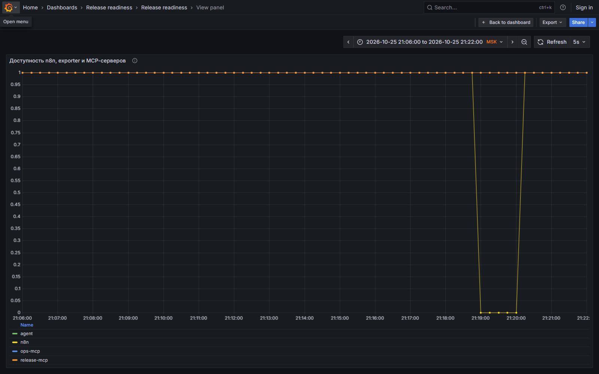

### Успехи и ошибки

На графике видны две ошибки и серия завершённых проверок. Панель показывает прирост за минуту. Дробные значения появляются из расчёта Prometheus между опросами.

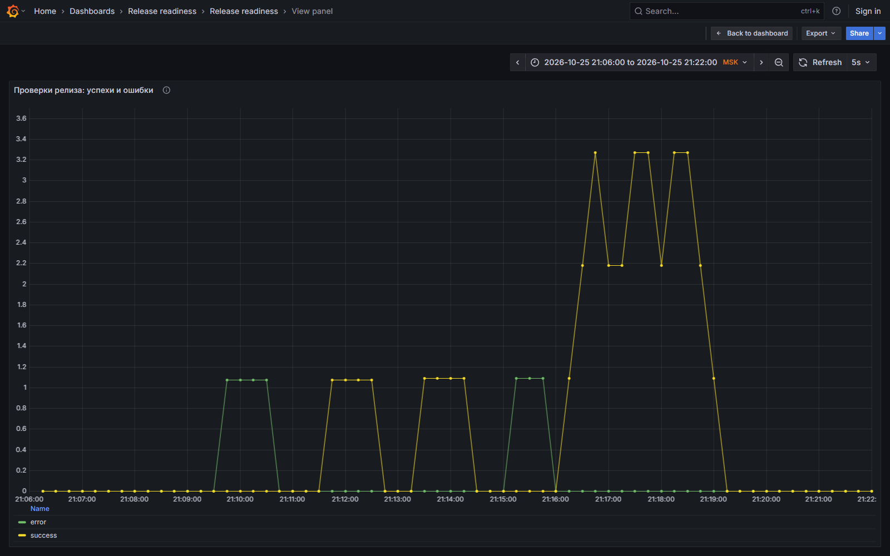

### Длительность

Во время повторной серии p95, оценка 95-го процентиля длительности проверки, составил 19,5 секунды. Он рассчитан по интервалам гистограммы; среднее HTTP-время измерено клиентом отдельно.

```console
PS ...\lab-7\release-readiness> curl.exe -fsS -G http://127.0.0.1:49090/api/v1/query `
> --data-urlencode 'query=histogram_quantile(0.95, sum by (le) (rate(release_check_duration_seconds_bucket{job="agent"}[2m])))' `
> --data-urlencode 'time=2026-10-25T18:17:30Z' -o results/latency-query.json

PS ...\lab-7\release-readiness> Get-Content -Raw results/latency-query.json
{"status":"success","data":{"resultType":"vector","result":[{"metric":{},"value":[1792952250,"19.5"]}]}}
```

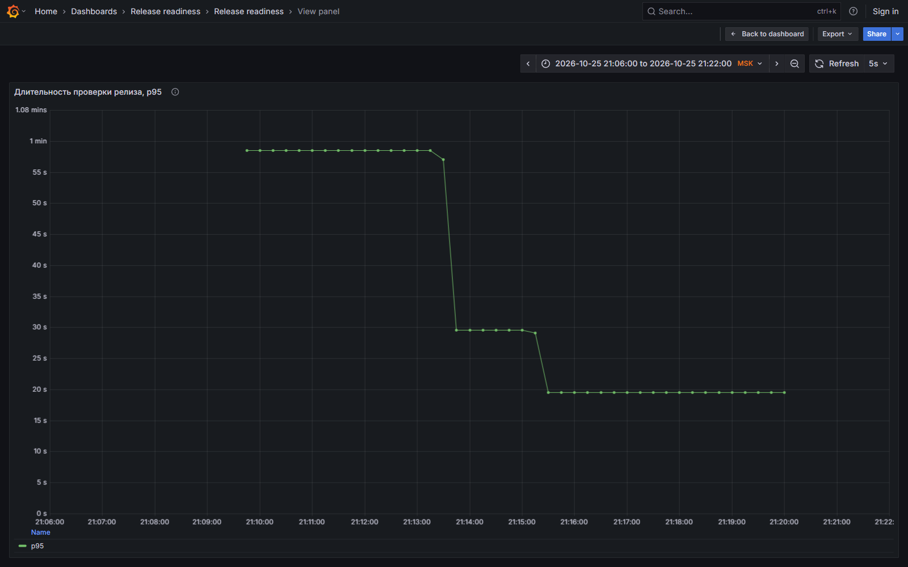

## Три алерта

В [alerts.yml](release-readiness/monitoring/alerts.yml) выбраны три метрики и условия:

- **Доступность n8n:** `up{job="n8n"} == 0` в течение 20 секунд. Без n8n новые проверки не запускаются. Правило называется `N8nUnavailable`.
- **Число ошибок:** прирост `release_checks_total{status="error"}` за две минуты больше нуля. Ошибка модели, MCP или сохранения оставляет запрос без отчёта. Правило `ReleaseCheckFailed` сообщает об этом.
- **Длительность:** p95 по `release_check_duration_seconds` выше 30 секунд в течение 30 секунд. Дополнительно нужна частота завершений больше 0,01/с за две минуты. Правило `ReleaseCheckSlow` обнаруживает задержку и не срабатывает без запросов.

Проверены конфигурация и [тесты трёх правил](release-readiness/monitoring/alerts.test.yml).

```console
PS ...\lab-7\release-readiness> docker compose exec -T prometheus promtool check config /etc/prometheus/prometheus.yml
Checking /etc/prometheus/prometheus.yml
  SUCCESS: 1 rule files found
 SUCCESS: /etc/prometheus/prometheus.yml is valid prometheus config file syntax

Checking /etc/prometheus/alerts.yml
  SUCCESS: 3 rules found

PS ...\lab-7\release-readiness> docker run --rm `
> --mount "type=bind,source=$((Get-Location).Path)\monitoring,target=/etc/prometheus,readonly" `
> --entrypoint promtool prom/prometheus:v3.5.0 test rules /etc/prometheus/alerts.test.yml
  SUCCESS

PS ...\lab-7\release-readiness> docker compose exec -T alertmanager amtool check-config /etc/alertmanager/alertmanager.yml
Checking '/etc/alertmanager/alertmanager.yml'  SUCCESS
Found:
 - global config
 - route
 - 0 inhibit rules
 - 1 receivers
 - 0 templates
```

Для проверки доступности выполнены `docker compose stop n8n` и затем `docker compose start n8n`. Сохранено состояние [N8nUnavailable: firing](release-readiness/results/n8n-down-alerts.json). На неизвестном релизе сработал [ReleaseCheckFailed](release-readiness/results/check-error-alerts.json). Правило задержки проверено через promtool; в этой серии оно не сработало.

[Alertmanager](release-readiness/monitoring/alertmanager.yml) доставил уведомления в локальный HTTP-приёмник. Сохранены срабатывания и восстановления:

```console
PS ...\lab-7\release-readiness> Get-Content results/alerts.jsonl | ForEach-Object { `
> $labEvent = $_ | ConvertFrom-Json; foreach ($labAlert in $labEvent.alerts) { `
> '{0} {1}' -f $labAlert.name,$labAlert.status } }
ReleaseCheckFailed firing
ReleaseCheckFailed resolved
ReleaseCheckFailed firing
ReleaseCheckFailed resolved
N8nUnavailable firing
N8nUnavailable resolved
```

Записи уведомлений находятся в [alerts.jsonl](release-readiness/results/alerts.jsonl).
